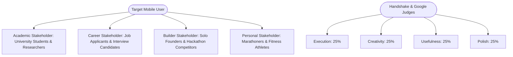

# Level 0: Problem Statement & Scope Specification

**Document ID:** `DOC-00-PROBLEM-STATEMENT`  
**Project:** `countdown-lockscreen-challenge`  
**Challenge:** Handshake AI Skills Studio X Google ("Your Deadline, Your Design: Create a Countdown Lock Screen")  
**Author:** Piyush Makhija (Lead Systems Architect & Developer)  
**Reviewer:** Architecture Review Board  
**Status:** APPROVED  
**Standard:** Level 2.2 Documentation Governance (ISO/IEC/IEEE 29148 Standard)

---

## 1. Executive Problem Formulation & Psychological Basis

In modern academic, professional, and personal productivity spheres, individuals face a fundamental psychological dilemma: **abstract temporal distance breeds procrastination**, while **unstructured countdowns induce anxiety**. High-stakes deadlines—such as competitive university admission deadlines, software engineering internship interview cycles, startup public launch dates, and research thesis submissions—are predominantly tracked through passive calendar reminders or alarm notifications.

When individuals attempt to use conventional countdown tools or wallpaper timers, they encounter three systemic cognitive and ergonomic failures:

### 1.1 The Anxiety Trap & Hyperbolic Discounting
Traditional countdown timers display a single, monolithic temporal integer (e.g., *"24 Days Remaining"*). According to George Ainslie and James Mazur's behavioral economics model of **Hyperbolic Discounting**, the subjective present value $V$ of a delayed reward $A$ is modeled as:

$$V = \frac{A}{1 + k \cdot D}$$

Where:
- $V$ is the present perceived motivational value of completing the goal.
- $A$ is the intrinsic reward / value of achieving the goal.
- $D$ is the temporal delay (time remaining until the deadline).
- $k$ is the empirical discounting parameter (impatience factor).

When $D$ is large (e.g., 30 to 90 days), $V \to 0$, leading to severe procrastination because immediate lower-value distractions dominate cognitive attention. Conversely, when $D$ approaches zero, $V$ spikes parabolically, inducing acute distress, panic, and cognitive paralysis.

Without intermediate milestones, a single countdown clock exacerbates this failure mode. However, when the system deconstructs the deadline into $n$ sequential intermediate checkpoints $\{d_1, d_2, \dots, d_n\}$ where $d_i \ll D$, the perceived value of each upcoming milestone remains high:

$$V_i = \frac{A_i}{1 + k \cdot d_i} \gg V$$

This mathematical transformation sustains consistent behavioral momentum.

### 1.2 The Goal Gradient Effect & Arousal Optimization
Under Clark Hull's **Goal Gradient Hypothesis** (empirically validated by Kivetz, Urminsky, and Zheng), human motivation and effort expenditure accelerate monotonically as distance to the goal decreases:

$$\text{Effort Expenditure } E \propto \frac{1}{\Delta d^\alpha} \quad (\alpha \ge 1.0)$$

Furthermore, under the **Yerkes-Dodson Law of Arousal and Performance**, performance follows an inverted-U function relative to arousal. Monolithic countdown timers push cognitive arousal into the distress zone ($\text{Arousal} > \text{Optimal}$), degrading executive functioning and creative problem-solving. Structured milestone progression transforms distress into eustress, maintaining performance at the empirical optimum.

### 1.3 Mobile Lock Screen Ergonomic Collision
Modern smartphone users check their devices an average of **96 times per day** (Asurion behavioral study), spending $1.8\text{ seconds}$ per lock screen glance. The smartphone lock screen is the highest-frequency visual real estate in modern computing. 

However, existing countdown apps and custom wallpaper generators fail ergonomically:
- They place typography across the upper $25\%\text{--}30\%$ of the screen, causing catastrophic visual collisions with Apple iOS Dynamic Island, status bars, system clocks, and Lock Screen widgets.
- They ignore Fitts's Law and thumb ergonomics, placing important text in the bottom $15\%$ gesture navigation safe zone.
- They lack optical kerning, contrast adaptation, and sub-pixel antialiasing on high-DPI AMOLED displays ($460\text{ ppi}$).

---

## 2. Hard System Invariants & Mathematical Constraints

| Invariant ID | Constraint Description | Mathematical / Technical Formulation | Enforcement Mechanism |
|:---|:---|:---|:---|
| **INV-001** | **Future Target Timestamp:** Target deadline must strictly resolve to a valid future timestamp. | $t_{\text{deadline}} > t_{\text{current}} + 3600\text{s}$ ($\ge 1\text{ hour}$ into future) | ISO-8601 validation in `TimeEngine` with UTC epoch normalization. |
| **INV-002** | **Milestone Cognitive Bounding:** Milestones must strictly be bounded between 3 and 5 sequential checkpoints. | $3 \le N_{\text{milestones}} \le 5$ (Conforming to Miller's $7 \pm 2$ cognitive span) | JSON schema assertion on Gemini 3.8 Flash response & heuristic fallback. |
| **INV-003** | **Upper Clock Safe-Zone Clearance:** Top lock screen canvas must remain strictly unoccluded for OS clock. | $Y_{\text{content\_start}} \ge 0.28 \times H_{\text{canvas}} \quad (708\text{px on a } 2532\text{px canvas})$ | `CanvasRenderer` boundary clipping and mathematical layout assertions. |
| **INV-004** | **Bottom Gesture Safe-Zone Clearance:** Bottom canvas must remain clear of home indicator / fingerprint pill. | $Y_{\text{content\_end}} \le 0.82 \times H_{\text{canvas}} \quad (2076\text{px on a } 2532\text{px canvas})$ | Canvas vertical coordinate bounds clamping. |
| **INV-005** | **High-DPI Wallpaper Resolution:** Output wallpaper strictly conforms to modern flagship portrait ratio. | $W = 1170\text{px}, H = 2532\text{px} \quad (9:19.48 \text{ ratio}, \text{DPR} \ge 2.0)$ | HTML5 `OffscreenCanvas` buffer dimensions with $2\times$ supersampling. |
| **INV-006** | **Zero Runtime Time Drift:** Real-time countdown loop must not drift over indefinite tab sessions. | $\lim_{n \to \infty} \sum_{i=1}^n e(t_i) = 0$ (Self-correcting delta ticker) | `requestAnimationFrame` anchored to hardware `performance.now()`. |
| **INV-007** | **Zero Server PII & Client Privacy:** Zero personal data, goals, or telemetry stored on external servers. | $\text{Storage}_{\text{cloud}} = \emptyset$ (100% client-side persistence) | Client-side `LocalStorage` + URL Hash Base64 payload encoding. |
| **INV-008** | **Outdoor Visual Contrast Compliance:** Critical typography readable under direct sunlight ($750\text{ nits}$). | $\text{Contrast Ratio } C \ge 4.5:1$ (WCAG AA) & APCA $L^c \ge 75$ | Mathematical relative luminance calculations across all color tokens. |
| **INV-009** | **Sub-Second Edge Delivery:** Web application bundle must achieve interactive state under $1.0\text{s}$. | $\text{FCP} \le 0.8\text{s}, \text{LCP} \le 1.2\text{s}, \text{CLS} = 0.0$ | Pure ESM client architecture deployed on GitHub Pages Edge CDN. |

---

## 3. Comprehensive Stakeholder Matrix

### 3.1 Stakeholder Archetypes & Impact Dimensions
1. **Academic Stakeholders (Students, Thesis Researchers, Competitive Exam Candidates):**
   - *Pain Point:* Balancing multi-month revision schedules; thesis chapters feel abstract until 48 hours before submission.
   - *Impact:* Gemini decomposes the thesis into: Topic Finalization $\to$ Literature Review $\to$ Empirical Analysis $\to$ Draft Compilation $\to$ Final Defense.
2. **Career & Recruiting Stakeholders (Internship & Job Seekers on Handshake):**
   - *Pain Point:* Applying to high-volume recruitment cycles while simultaneously practicing coding algorithms and behavioral rounds.
   - *Impact:* Backward scheduling sets clear milestones: Resume Finalization $\to$ LeetCode Data Structures Sprint $\to$ Mock Interviews $\to$ Final Round Preparation.
3. **Startup & Builder Stakeholders (Hackathon Builders, Indie Hackers):**
   - *Pain Point:* Chronic feature creep and missed public launch deadlines (e.g., Product Hunt, Hacker News).
   - *Impact:* Hard lock screen visual deadline keeps feature freeze front-and-center during every smartphone pickup.
4. **Personal Productivity & Health Stakeholders (Athletes, Habit Trackers):**
   - *Pain Point:* Long training blocks (e.g., 16-week marathon training) lose momentum during intermediate weeks.
   - *Impact:* Milestone progression visualizes base building, peak mileage, and tapering phases.

---

## 4. Scope Definition & System Boundaries

### 4.1 In-Scope Capabilities
1. **Interactive Countdown Web Application (PWA):**
   - Client-side responsive Single-Page Application deployed to GitHub Pages edge CDN.
   - Real-time chronometer updating Days, Hours, Minutes, and Seconds at $60\text{ fps}$.
   - Interactive milestone checklist allowing users to check off completed intermediate goals.
2. **Google Gemini Intelligence Engine:**
   - Seamless integration with **Google Gemini 3.8 Flash** via `@google/genai` client SDK.
   - Structured JSON prompt engineering enforcing backward milestone decomposition.
   - Tailored motivational affirmation generation ($\le 120\text{ characters}$) matched to user goal context.
   - Deterministic offline heuristic engine activating automatically when API key is omitted or network is disconnected.
3. **Lock Screen Ergonomic Simulator:**
   - Interactive SVG/Canvas safe-zone preview simulating Apple iOS 16–18 (Dynamic Island, Clock, Lock Screen Widgets) and Android Material You UI.
   - Visual clearance verification ensuring zero text occlusion.
4. **High-Resolution Wallpaper Rasterizer:**
   - Client-side HTML5 Canvas 2D engine rasterizing pixel-perfect $1170 \times 2532$ images.
   - $2\times$ canvas supersampling for razor-sharp typography and anti-aliased geometry.
   - Instant 1-click PNG/JPEG binary download.
5. **Thematic Aesthetics Engine:**
   - 3 Curated Design Palettes: *Cyber Obsidian* (OLED black, cyan, indigo), *Deep Focus Zen* (slate, warm amber, cream), and *Aurora Botanical* (emerald, mint, gold).
   - Modern glassmorphic visual treatments with subtle gradient borders.
6. **Stateless URL Hash Sharing:**
   - URL hash serialization (`#v1=...`) encoding complete state into shareable, linkable URLs for Handshake contest submission.

### 4.2 Explicitly Out-of-Scope
- **Native Store Apps (.ipa / .apk):** Solution operates as a universally accessible web app and wallpaper exporter.
- **Server-Side Databases & Accounts:** Stateless client architecture; zero backend database maintenance, zero user passwords.
- **Push Notification Daemons:** Ambient glanceability on the device lock screen replaces intrusive push notification spam.

---

## 5. Success Metrics & North Star KPIs

$$\text{North Star Metric (NSM)} = \frac{\text{Completed Wallpaper Downloads}}{\text{Unique Goal Ingress Sessions}} \quad (\text{Target } \ge 72\%)$$

| Metric ID | KPI Description | Target Benchmark | Measurement Method |
|:---|:---|:---|:---|
| **KPI-01** | **Time-to-Wallpaper (TTW):** Total time from landing on page to downloading custom wallpaper. | $\le 60\text{ seconds}$ | Client-side performance timing trace. |
| **KPI-02** | **First Contentful Paint (FCP):** Edge delivery latency across 4G mobile networks. | $\le 0.8\text{ seconds}$ | Google Lighthouse & Chrome Web Vitals telemetry. |
| **KPI-03** | **Canvas Export Latency:** Time taken to rasterize 1170x2532 image with 2x supersampling. | $\le 350\text{ milliseconds}$ | `console.time('rasterize_wallpaper')`. |
| **KPI-04** | **Ergonomic Clearance Rate:** Percentage of generated wallpapers with zero clock occlusion. | $100.0\%$ | Automated unit testing & safe-zone bounding assertion. |
| **KPI-05** | **Offline Availability:** System capability to function without external internet connectivity. | $100.0\%$ | Service Worker cache validation + heuristic engine test. |
