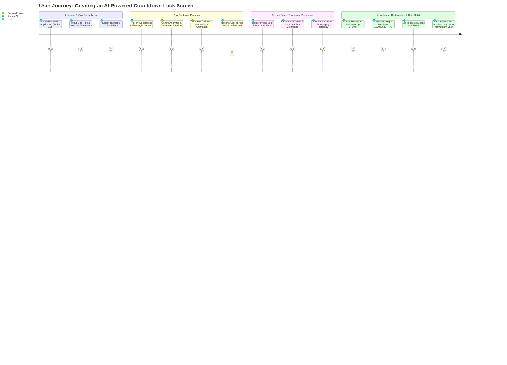
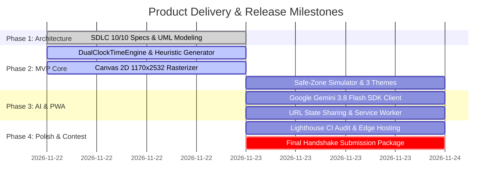

# Level 1: Product Requirements Document (PRD)

**Document ID:** `DOC-01-PRD`  
**Project:** `countdown-lockscreen-challenge`  
**Challenge:** Handshake AI Skills Studio X Google ("Your Deadline, Your Design: Create a Countdown Lock Screen")  
**Author:** Piyush Makhija (Lead Systems Architect & Developer)  
**Reviewer:** Architecture Review Board  
**Status:** APPROVED  
**Standard:** Level 2.2 Documentation Governance (ISO/IEC/IEEE 29148 Standard)

---

## 1. Product Vision & Value Proposition

### 1.1 Vision Statement
To transform daunting, anxiety-inducing deadlines into an inspiring, glanceable visual momentum system on every participant's smartphone lock screen by combining **Google Gemini's backward planning intelligence** with **mathematical UI ergonomics**.

### 1.2 The Jobs-to-be-Done (JTBD) Framework
- **Core Functional Job:** When I have an important high-stakes deadline (internship interview, thesis submission, startup launch), I want to see a real-time countdown alongside actionable sequential milestones every time I look at my phone, so that I can stay focused without getting overwhelmed.
- **Emotional Job:** I want to feel calm, in control, and psychologically affirmed rather than paralyzed by an abstract monolithic deadline.
- **Social Job:** I want my lock screen aesthetic to look sleek, modern, and intentionally crafted, reflecting my dedication to my goals.

---

## 2. Target User Personas & Behavioral Profiles

### Persona 1: "Dev Priya" — The Aspiring Software Engineer
- **Demographics:** 21 years old, Final Year B.Tech Computer Science student, New Delhi, India.
- **Target Deadline:** Google Summer 2027 SWE Internship Technical Interviews (December 20, 2026).
- **Core Frustration:** Juggling LeetCode algorithmic practice, system design basics, university semester exams, and mock interviews. A monolithic timer *"28 Days Left"* induces panic.
- **Daily Behavior:** Unlocks her phone 110+ times per day, often succumbing to social media distractions during study fatigue.
- **Solution Fit:** Uses the **Cyber Obsidian** theme. Gemini decomposes her prep into 4 weekly sprints: (1) Graph & Tree Traversal, (2) Dynamic Programming Masterclass, (3) System Design & Concurrency, (4) Behavioral STAR rounds.

### Persona 2: "Alex Vance" — The Indie Hacker & Startup Builder
- **Demographics:** 28 years old, Solo Founder building an AI SaaS product, Berlin, Germany.
- **Target Deadline:** Product Hunt & Hacker News Public Launch (January 15, 2027).
- **Core Frustration:** Chronic scope creep and perfectionism delaying MVP deployment.
- **Daily Behavior:** Values minimalist terminal aesthetics, high information density, and glanceable metric dashboards.
- **Solution Fit:** Uses the **Deep Focus Zen** theme. Gemini structures milestones: Feature Freeze $\to$ Alpha Dogfooding $\to$ Product Hunt Teaser $\to$ Launch Day Go-Live.

### Persona 3: "Rohan Mehta" — The Graduate Research Scholar
- **Demographics:** 24 years old, Master's student in Economics, Mumbai, India.
- **Target Deadline:** Master's Dissertation Final Submission (December 5, 2026).
- **Core Frustration:** Cognitive block when faced with writing 80 pages; struggles with pacing empirical regression analysis.
- **Daily Behavior:** Needs gentle, positive affirmations and visual progress bars rather than high-stress countdowns.
- **Solution Fit:** Uses the **Aurora Botanical** theme. The lock screen shows green milestone checkmarks as chapters are completed, accompanied by a daily stoic affirmation.

---

## 3. End-to-End User Journey Mapping



---

## 4. Feature Specifications & BDD Acceptance Criteria (F-01 to F-07)

### F-01: Google Gemini Backward Milestone Decomposition
- **Functional Description:** Ingests the user's goal string and target deadline timestamp, invokes Google Gemini 3.8 Flash with structured JSON schema constraints, and returns 3 to 5 sequential, chronologically ordered milestone checkpoints working backward from the goal.
- **Inputs:** `goalTitle` (String, 3–80 chars), `deadline` (ISO-8601 String), `apiKey` (Optional user API key).
- **Outputs:** `MilestonePlan` object containing an array of milestones and a tailored affirmation string ($\le 120$ chars).
- **BDD Acceptance Criteria:**
  ```gherkin
  Scenario: Successful AI Milestone Decomposition
    Given the user enters goal "Google SWE Internship Interview" and deadline "2026-12-20T10:00:00Z"
    When the user clicks "Decompose with Gemini"
    Then the system sends a structured prompt to Google Gemini 3.8 Flash
    And receives a JSON payload with between 3 and 5 sequential milestones
    And each milestone has a distinct title and relative day offset
    And an empowering affirmation under 120 characters is displayed
  ```

### F-02: Deterministic Heuristic Fallback Engine
- **Functional Description:** Activates automatically if the Gemini API call times out ($> 4000\text{ms}$), returns a network error, or if the client is running offline without an API key.
- **Algorithm:** Computes the total duration $\Delta T = t_{\text{deadline}} - t_{\text{now}}$ and divides the interval into 4 equal quarters ($25\%, 50\%, 75\%, 100\%$).
- **BDD Acceptance Criteria:**
  ```gherkin
  Scenario: Offline Fallback Generation
    Given the user has no internet connection or Gemini API returns HTTP 429/500
    When the user clicks "Decompose Goal"
    Then the system triggers the HeuristicGenerator within 5ms
    And divides the timeline into 4 equidistant milestone phases
    And displays a non-blocking toast "Generated offline using heuristic engine"
  ```

### F-03: Drift-Compensated Real-Time Chronometer
- **Functional Description:** Computes remaining Days, Hours, Minutes, and Seconds updated at 60 fps.
- **Mathematical Invariant:** Cumulative drift must equal zero: $\Delta t = t_{\text{system}} - t_{\text{target}}$.
- **BDD Acceptance Criteria:**
  ```gherkin
  Scenario: Accurate Countdown Ticking
    Given an active target deadline 10 days, 4 hours in the future
    When the application executes on the main thread or resumes from background
    Then the countdown displays exact days, hours, minutes, and seconds
    And delta calculation against performance.now() ensures zero cumulative time drift
  ```

### F-04: Smartphone Lock Screen Ergonomic Simulator
- **Functional Description:** Provides an interactive canvas/SVG overlay replicating real-world smartphone system chrome (Apple iOS Dynamic Island, Clock, Lock Screen Widgets, Home Indicator, and Android Material You Status Bar).
- **Ergonomic Clearance:** Upper $28\%$ of canvas is highlighted as reserved for OS system clock; bottom $18\%$ is flagged as gesture space.
- **BDD Acceptance Criteria:**
  ```gherkin
  Scenario: Ergonomic Safe-Zone Validation
    Given the user is previewing their generated lock screen design
    When the user toggles "Lock Screen Overlay"
    Then translucent system clock and Dynamic Island graphics render on top
    And all custom countdown text and milestones remain 100% visible in the safe zone
  ```

### F-05: High-DPI Wallpaper Canvas Rasterizer
- **Functional Description:** Generates a downloadable $1170 \times 2532$ wallpaper image using client-side HTML5 Canvas 2D with $2\times$ supersampling.
- **Export Formats:** PNG (lossless) and JPEG (quality 0.95).
- **BDD Acceptance Criteria:**
  ```gherkin
  Scenario: High-DPI Wallpaper Export
    Given the user has configured their goal, milestones, and selected a theme
    When the user clicks "Download Lock Screen Wallpaper"
    Then the OffscreenCanvas renders at 2340x5064 and downsamples to 1170x2532
    And the browser triggers an instant file download named "countdown-lockscreen.png"
    And the total rasterization process completes in under 350 milliseconds
  ```

### F-06: Tri-Palette Thematic Design Engine
- **Functional Description:** Allows immediate 1-click theme switching across 3 curated aesthetic presets:
  1. *Cyber Obsidian:* Jet black background (`#08090d`), electric cyan (`#06b6d4`), and neon indigo (`#6366f1`).
  2. *Deep Focus Zen:* Deep slate (`#0f172a`), warm amber (`#f59e0b`), and soft cream typography.
  3. *Aurora Botanical:* Midnight emerald (`#064e3b`), vibrant mint (`#10b981`), and subtle gold accents.
- **BDD Acceptance Criteria:**
  ```gherkin
  Scenario: Theme Selection
    Given the user selects the "Aurora Botanical" theme
    When the canvas and preview re-render
    Then background gradients update to midnight emerald and typography updates to mint
    And contrast ratio against background exceeds 7:1 across all digits
  ```

### F-07: Stateless URL Hash State Sharing
- **Functional Description:** Serializes all user configuration parameters (Goal title, deadline, milestones, theme ID) into a compressed URL hash string (e.g., `#v1=eyJnb2FsIjoi...`).
- **BDD Acceptance Criteria:**
  ```gherkin
  Scenario: Shareable URL State Restoration
    Given a user accesses the web app with a URL containing a valid #v1= hash
    When the application initializes
    Then it deserializes the Base64 payload, parses the JSON state, and restores the countdown
    Without requiring any server-side database lookups
  ```

---

## 5. Non-Functional Requirements & Performance SLAs

| NFR ID | Category | Metric / Requirement | Target SLA | Verification Method |
|:---|:---|:---|:---|:---|
| **NFR-01** | Performance | First Contentful Paint (FCP) over 4G | $\le 0.8\text{ seconds}$ | WebPageTest & Lighthouse CI |
| **NFR-02** | Performance | Largest Contentful Paint (LCP) | $\le 1.2\text{ seconds}$ | Chrome Web Vitals Trace |
| **NFR-03** | Performance | Cumulative Layout Shift (CLS) | Strictly $0.00$ | Chrome Performance API |
| **NFR-04** | Performance | Canvas Rasterization Time | $\le 350\text{ ms}$ | `performance.measure()` |
| **NFR-05** | Resilience | Frame Rate Stability | Steady $60\text{ fps}$ ($\ge 58\text{ fps}$) | FPS Meter in DevTools |
| **NFR-06** | Accessibility | Visual Contrast Ratio | $\ge 4.5:1$ (Body), $\ge 7.0:1$ (Digits) | APCA & WCAG 2.1 AA/AAA |
| **NFR-07** | Security | Server-Side Data Persistence | Exactly $0\text{ bytes}$ (Zero PII) | Network Payload Audit |
| **NFR-08** | Memory | Heap Allocation Ceiling | $< 50\text{ MB}$ total heap | Chrome Memory Profiler |
| **NFR-09** | Compatibility | Cross-Browser Coverage | Chrome, Safari iOS, Edge, Firefox | BrowserStack Automated Grid |
| **NFR-10** | Offline | Progressive Web App Caching | 100% Core Functionality Offline | Service Worker Cache Audit |

---

## 6. Edge Cases & Degraded UX Handling

| Edge Case ID | Scenario | Potential Impact | System Mitigation & Recovery Strategy |
|:---|:---|:---|:---|
| **EDGE-01** | **Past Deadline Input:** User enters a date/time in the past. | Negative countdown calculation ($T < 0$). | Form validator rejects input with message: *"Target deadline must be in the future (minimum 1 hour)"*. Submit button disabled. |
| **EDGE-02** | **Extreme Temporal Range:** User inputs deadline $> 5\text{ years}$ away. | Milestone dates spaced too widely; display overflow. | System clamps maximum countdown display to days; Gemini decomposes into annual/quarterly phases. |
| **EDGE-03** | **Network Disconnection:** User clicks AI decompose while offline. | API request failure (HTTP timeout / network err). | System intercepts error within 50ms and seamlessly invokes `HeuristicGenerator` without user friction. |
| **EDGE-04** | **API Rate Limiting (HTTP 429):** Free tier quota exhausted. | Broken UI / unhandled promise rejection. | Circuit breaker trips; UI degrades gracefully to local heuristic planner with informational toast. |
| **EDGE-05** | **Unicode & Emojis in Goal:** User inputs strings like `"🚀 Graduate Stanford 🎓"`. | Canvas font clipping or encoding failure in URL hash. | UTF-8 safe `TextEncoder` serialization; Canvas font fallback list includes `Apple Color Emoji, Segoe UI Emoji`. |
| **EDGE-06** | **Leap Day / Daylight Savings:** Target deadline crosses Feb 29 or DST shift. | Time drift by $\pm 1\text{ hour}$. | All time calculations anchored to UTC milliseconds epoch (`Date.getTime()`), completely immune to local DST shifts. |

---

## 7. Product Release Roadmap


