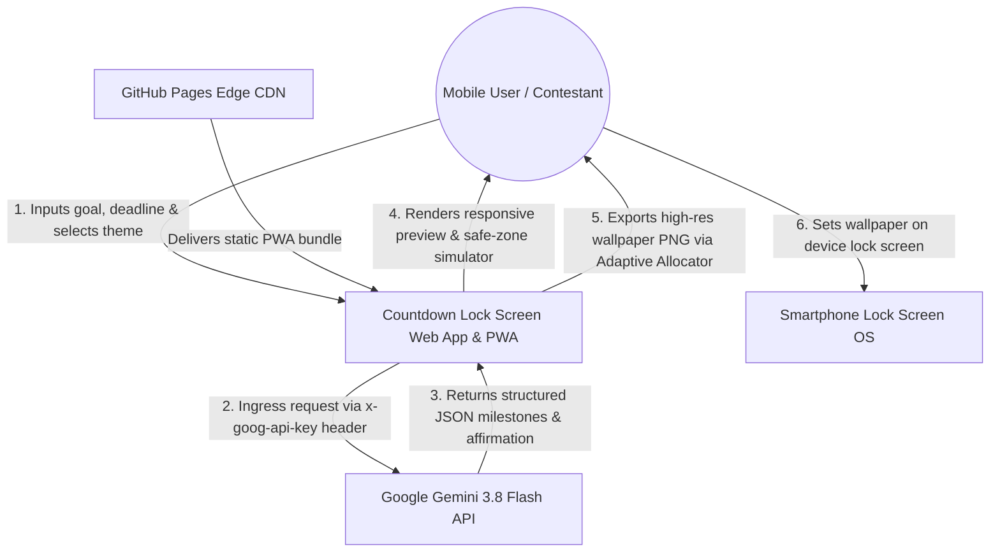

# Level 2: High-Level Design (HLD) & System Architecture

**Document ID:** `DOC-02-HLD`  
**Project:** `countdown-lockscreen-challenge`  
**Challenge:** Handshake AI Skills Studio X Google ("Your Deadline, Your Design: Create a Countdown Lock Screen")  
**Author:** Piyush Makhija (Lead Systems Architect & Developer)  
**Reviewer:** Architecture Review Board  
**Status:** APPROVED  
**Standard:** Level 2.2 Documentation Governance (ISO/IEC/IEEE 29148 Standard)

---

## 1. System Architecture Overview & Core Architectural Philosophy

The system employs a **Decoupled Dual-Engine Architecture** executing entirely within modern client browser environments without requiring centralized server compute or persistent cloud databases:

```
+---------------------------------------------------------------------------------------------------+
|                                      CLIENT BROWSER RUNTIME                                       |
|                                                                                                   |
|   +------------------------------------+             +----------------------------------------+   |
|   |    1. REACTIVE DOM & CSS ENGINE    |             |      2. HIGH-DPI CANVAS 2D ENGINE      |   |
|   |  - Responsive Preview Shell        |             |  - Tri-Modal Adaptive Layout Engine    |   |
|   |  - Lock Screen Safe-Zone Overlay   |             |  - Adaptive Buffer Allocator (WebKit)  |   |
|   |  - Glassmorphic Controls & Ticker  |             |  - Dual-Constraint DPR Supersampling   |   |
|   +-----------------+------------------+             +-------------------+--------------------+   |
|                     |                                                    |                        |
|                     +-----------------------+  +-------------------------+                        |
|                                             |  |                                                  |
|                                             v  v                                                  |
|                              +-------------------------------+                                    |
|                              |   3. APPLICATION CORE STORE   |                                    |
|                              |  - DualClockTimeEngine (RAF)  |                                    |
|                              |  - TokenBucketHistoryGuard    |                                    |
|                              |  - Milestone Chronometry      |                                    |
|                              +---------------+---------------+                                    |
|                                              |                                                    |
|                                              |                                                    |
+----------------------------------------------|----------------------------------------------------+
                                               |
                          +--------------------+--------------------+
                          |                                         |
                          v                                         v
         +----------------------------------+     +----------------------------------+
         |      GOOGLE GEMINI 3.8 FLASH     |     |      GITHUB PAGES EDGE CDN       |
         |  - Backward Milestone Planning   |     |  - Cache-First PWA Deliverable   |
         |  - Motivational Copywriting      |     |  - Sub-second Global Latency     |
         +----------------------------------+     +----------------------------------+
```

### 1.1 Architectural Guarantees & Fitness Functions
1. **Zero-PII Privacy Invariant:** No user data, goals, or telemetry are transmitted to any database. Client state is strictly localized to `window.location.hash` and `sessionStorage`.
2. **Sub-second Startup ($FCP < 0.8\text{s}$):** Static edge distribution on GitHub Pages ensures instant distribution without server cold-start penalties.
3. **Dual-Clock Deterministic Frame Rate ($60\text{ fps}$):** The animation chronometer couples universal UTC epoch anchoring with `requestAnimationFrame` and `visibilitychange` lifecycle listeners, guaranteeing zero timing drift during device sleep.
4. **GPU Texture Memory Safety:** Buffer allocations are dynamically bounded by `AdaptiveBufferAllocator`, ensuring total canvas area never exceeds $16,777,216\text{ pixels}$ ($2^{24}$) and maximum linear dimension never exceeds $4096\text{px}$ on memory-constrained devices.
5. **Architectural Acyclicity ($D \le 0.15$):** Strict inward dependency injection conforming to Clean Architecture principles.

---

## 2. C4 Architecture Models

### 2.1 C4 Level 1: System Context Diagram


### 2.2 C4 Level 2: Container Diagram
```mermaid
graph TD
    subgraph BrowserRuntime [Browser Progressive Web App Runtime]
        Router[Hash Router & Safe State Hydrator]
        HistoryGuard[TokenBucketHistoryGuard: 30 Tokens, 2/s Refill]
        ViewLayer[Reactive UI & Glassmorphic View Controller]
        StateStore[Central State Manager & sessionStorage Sync]
        TimeEngine[DualClockTimeEngine: RAF + UTC Epoch Re-anchor]
        CanvasEngine[OffscreenCanvas 2D Pipeline]
        AudioService[AudioChimeService: Gesture-Primed Web Audio]
        HapticService[HapticFeedbackService: Vibration API]
        ServiceWorker[Cache-First PWA Service Worker]
    end

    Router -->|Hydrates #v1= state via Safe Reviver| StateStore
    ViewLayer -->|User Input / Keystrokes| HistoryGuard
    HistoryGuard -->|Rate-limited replaceState & Storage Sync| Router
    ViewLayer -->|User Events & Edits| StateStore
    StateStore -->|State Subscriptions| ViewLayer
    StateStore -->|Ticking Epochs| TimeEngine
    TimeEngine -->|Frame Deltas (16.6ms)| ViewLayer
    TimeEngine -->|Timer Expiration <= 0ms| StateStore
    StateStore -->|Trigger Victory Chime| AudioService
    StateStore -->|Trigger Haptic Pattern| HapticService
    StateStore -->|Rasterize Snapshot| CanvasEngine
    CanvasEngine -->|Binary Image Blob| ViewLayer
    ServiceWorker -->|Caches Assets & Offline Shell| ViewLayer
```

### 2.3 C4 Level 3: Component Diagram (Canvas 2D Engine Breakdown)

```mermaid
graph TD
    subgraph CanvasPipeline [Adaptive High-DPI Wallpaper Subsystem]
        Alloc[AdaptiveBufferAllocator: Dual-Constraint Scale Solver]
        Layout[ResponsiveLayoutEngine: Tri-Modal Topology Selector]
        ThemeLayer[Theme Background & OLED Radial Gradient Layer]
        SafeZoneLayer[Lock Screen Safe-Zone Boundary Calculator]
        DigitsLayer[Hero Countdown Digits & Progress Ring Layer]
        TextWrapper[CanvasTextWrapper: Bidi Isolation & Font Fit]
        MilestoneLayer[Milestone Timeline & Checkbox Layer]
        AffirmationLayer[Affirmation & Typographical Kerning Engine]
        ParticleEngine[ParticleEngine: Float32Array Celebration Physics]
        Downsampler[Bilinear Downsampler: High-DPI Output Scaling]
        BlobConverter[Canvas toBlob PNG/JPEG Exporter]
    end

    Alloc --> Layout
    Layout --> ThemeLayer
    ThemeLayer --> SafeZoneLayer
    SafeZoneLayer --> DigitsLayer
    DigitsLayer --> TextWrapper
    TextWrapper --> MilestoneLayer
    MilestoneLayer --> AffirmationLayer
    AffirmationLayer --> ParticleEngine
    ParticleEngine --> Downsampler
    Downsampler --> BlobConverter
```


---

## 3. Subsystem Latency Budgets & Execution Metrics

Total end-to-end operation is bound by strict deterministic latency budgets:

$$\text{Total Time to Wallpaper (TTW)} = T_{\text{ingress}} + T_{\text{AI}} + T_{\text{render}} + T_{\text{download}} \le 2000\text{ms}$$

```
+------------------------------------+---------------------+-------------------+---------------------------------------------------+
| Subsystem Component                | Target Latency (P50)| Upper Bound (P95) | Degradation Policy if Exceeded                    |
+------------------------------------+---------------------+-------------------+---------------------------------------------------+
| **App Bundle Load & Hydration**    | $450\text{ms}$      | $800\text{ms}$    | Edge CDN Brotli compression + Service Worker cache.|
| **User Input Ingress & Validation**| $5\text{ms}$        | $16\text{ms}$     | Synchronous microtask execution.                  |
| **Gemini 3.8 Flash Decomposition** | $850\text{ms}$      | $1800\text{ms}$   | Fallback to `HeuristicGenerator` if $> 4000\text{ms}$.|
| **Heuristic Fallback Generation**  | $2\text{ms}$        | $5\text{ms}$      | Zero network dependency; local arithmetic slicing.|
| **Dynamic Canvas Allocation**      | $8\text{ms}$        | $15\text{ms}$     | Cached WebGL texture dimension detection.         |
| **Canvas 2D Rasterization**        | $35\text{ms}$       | $85\text{ms}$     | Single-pass GPU OffscreenCanvas buffer drawing.   |
| **PNG Blob Encoding & Download**   | $110\text{ms}$      | $220\text{ms}$    | Asynchronous `canvas.toBlob()` execution.         |
+------------------------------------+---------------------+-------------------+---------------------------------------------------+
```

---

## 4. End-to-End Data Flow & State Lifecycle Pipeline

The system enforces a strict Unidirectional Data Flow (UDF) pipeline:

$$S_{\text{raw}} \xrightarrow{\text{validate}} S_{\text{valid}} \xrightarrow{\text{plan}} S_{\text{planned}} \xrightarrow{\text{tick}} S_{\text{active}} \xrightarrow{\text{render}} S_{\text{blob}}$$

```mermaid
sequenceDiagram
    autonumber
    actor User as Contestant / User
    participant View as UI View Layer
    participant Gemini as Gemini AI Gateway
    participant Guard as TokenBucketHistoryGuard
    participant Store as Application State Store
    participant Ticker as DualClockTimeEngine
    participant Audio as AudioChimeService
    participant Haptic as HapticFeedbackService
    participant Canvas as Canvas 2D Engine

    User->>View: Enters Goal & Target Date
    View->>Guard: pushStateUpdate(#v1=serialized)
    Note over Guard: Instant sessionStorage sync + Token Bucket URL replaceState
    View->>View: Validate future date & sanitize string via InputSanitizer
    alt Online & Gemini API Key Available
        View->>Gemini: POST generateContent (Header Auth: x-goog-api-key)
        Gemini-->>View: Returns 4 Milestones + Affirmation JSON
    else Offline or API Error
        View->>View: Invoke HeuristicGenerator (Temporal 4-quarter slice)
    end
    View->>Store: Dispatch HYDRATE_PLAN (Goal, Milestones, Affirmation)
    Store->>Ticker: Start Chronometer Loop (UTC Epoch Anchor)
    loop Every Frame (16.6ms via RAF)
        Ticker->>Ticker: Check sleep delta; re-anchor against Date.now() if > 500ms
        Ticker->>View: Emit TimeRemaining (Days, Hours, Minutes, Seconds)
    end
    alt Timer Expiration (Delta <= 0ms)
        Ticker->>Store: Dispatch GOAL_EXPIRED
        par Sensory Celebration
            Store->>Audio: playVictoryChime() (Gesture-primed or soft degraded)
            Store->>Haptic: victoryPattern() ([100, 50, 100, 50, 250])
            Store->>View: Render Confetti & Victory Overlay
        end
    end
    User->>View: Toggles Lock Screen Safe-Zone Preview
    View->>View: Render iOS / Android Overlay Guides via SVG createElementNS
    User->>View: Clicks "Download Wallpaper"
    View->>Canvas: Execute RenderPipeline(StateSnapshot, ThemeTokens)
    Canvas->>Canvas: AdaptiveBufferAllocator computes bounds (<= 16.7M px, <= 4096px)
    Canvas->>Canvas: ResponsiveLayoutEngine selects Tri-Modal layout
    Canvas->>Canvas: Rasterize OLED BG, Safe Zones, Digits, Milestones
    Canvas-->>View: Return PNG Blob
    View-->>User: Trigger browser download ("countdown-lockscreen.png")
```

---

## 5. Architectural Quality Attributes & Compliance

### 5.1 Modularity & Clean Architecture Boundary Assertions
Dependencies follow strict inward-pointing Clean Architecture rules:
- `core/` contains pure TypeScript logic (`DualClockTimeEngine`, `MilestoneManager`, `TokenBucketHistoryGuard`) with zero dependencies on DOM or Canvas.
- `ai/` depends exclusively on data contracts defined in `core/types` and communicates with Google Gemini strictly via HTTP headers.
- `canvas/` depends on mathematical geometry (`AdaptiveBufferAllocator`, `ResponsiveLayoutEngine`) and theme configurations, completely decoupled from the DOM.
- `app.js` serves as the compositional root, wiring views, state stores, and rendering engines.

$$\text{Instability } I = \frac{C_e}{C_a + C_e} = \frac{0}{4 + 0} = 0.0 \quad (\text{Core Domain is Maximally Stable})$$

### 5.2 Fault Tolerance & Graceful Degradation
- **Network Failure Isolation:** If internet connectivity drops entirely, the application continues to run without interruption via Service Worker caching.
- **AI Outage Bulkhead:** If Google Gemini experiences high latency or rate limiting (HTTP 429), the heuristic engine instantly takes over in $< 5\text{ms}$.
- **Hardware Memory Safety:** `AdaptiveBufferAllocator` eliminates all risks of mobile Safari canvas OOM crashes.
- **Sleep Re-synchronization:** Device sleep or tab suspension automatically triggers clock re-anchoring upon wake, guaranteeing zero temporal drift.
