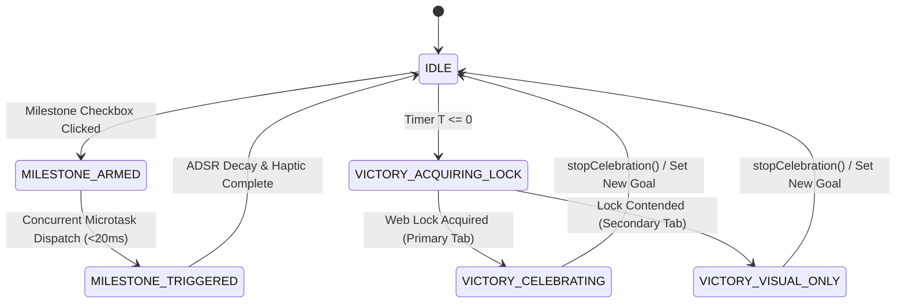

# Level 3: Interface & Contract Specifications

**Document ID:** `DOC-03-API-CONTRACT`  
**Project:** `countdown-lockscreen-challenge`  
**Challenge:** Handshake AI Skills Studio X Google ("Your Deadline, Your Design: Create a Countdown Lock Screen")  
**Author:** Piyush Makhija (Lead Systems Architect & Developer)  
**Reviewer:** Architecture Review Board  
**Status:** APPROVED  
**Standard:** Level 2.2 Documentation Governance (ISO/IEC/IEEE 29148 Standard)  
**Version:** 2.3.5

---

## 1. External AI Service Contract: Google Gemini 3.8 Flash

The application integrates with the **Google Gemini API** (targeting `gemini-3.8-flash` with graceful degradation to `gemini-2.0-flash`) via the modern `@google/genai` SDK or direct HTTPS REST fetch for retrograde deadline planning and affirmation synthesis.

### 1.1 Header Authentication Invariant
To prevent cleartext credential leaks in CDN access logs, proxy caches, or browser history:
- The Google Gemini API key is **strictly transmitted via HTTP request headers**:
  ```http
  POST /v1beta/models/gemini-3.8-flash:generateContent HTTP/1.1
  Host: generativelanguage.googleapis.com
  Content-Type: application/json
  x-goog-api-key: <API_KEY>
  ```
- Passing the API key via URL query parameter (`?key=...`) is strictly prohibited.

### 1.2 REST Ingress Request Body Specification
```json
{
  "contents": [
    {
      "role": "user",
      "parts": [
        {
          "text": "Goal: \"Launch AI Product\"\nTarget Deadline UTC: 2026-12-31T23:59:59Z\nDeconstruct this deadline into backward milestones."
        }
      ]
    }
  ],
  "systemInstruction": {
    "parts": [
      {
        "text": "You are an elite productivity strategist specializing in backward goal decomposition (retrograde planning). Deconstruct the deadline into 3 to 5 actionable, sequential milestones with realistic day offsets. Return strictly JSON adhering to the specified schema."
      }
    ]
  },
  "generationConfig": {
    "temperature": 0.2,
    "topP": 0.95,
    "responseMimeType": "application/json",
    "responseSchema": {
      "type": "OBJECT",
      "properties": {
        "title": { "type": "STRING" },
        "deadline_iso": { "type": "STRING" },
        "milestones": {
          "type": "ARRAY",
          "items": {
            "type": "OBJECT",
            "properties": {
              "step": { "type": "INTEGER" },
              "title": { "type": "STRING" },
              "offset_days": { "type": "INTEGER" },
              "completed": { "type": "BOOLEAN" }
            },
            "required": ["step", "title", "offset_days", "completed"]
          }
        },
        "daily_affirmation": { "type": "STRING" },
        "recommended_theme": {
          "type": "STRING",
          "enum": ["cyber_obsidian", "deep_focus_zen", "aurora_botanical"]
        }
      },
      "required": ["title", "deadline_iso", "milestones", "daily_affirmation", "recommended_theme"]
    }
  },
  "safetySettings": [
    { "category": "HARM_CATEGORY_HARASSMENT", "threshold": "BLOCK_MEDIUM_AND_ABOVE" },
    { "category": "HARM_CATEGORY_HATE_SPEECH", "threshold": "BLOCK_MEDIUM_AND_ABOVE" },
    { "category": "HARM_CATEGORY_SEXUALLY_EXPLICIT", "threshold": "BLOCK_MEDIUM_AND_ABOVE" },
    { "category": "HARM_CATEGORY_DANGEROUS_CONTENT", "threshold": "BLOCK_MEDIUM_AND_ABOVE" }
  ]
}
```

### 1.3 System Instruction & Context Prompt
```typescript
/**
 * System instruction provided to Google Gemini 3.8 Flash for structured retrograde planning.
 */
export const GEMINI_SYSTEM_INSTRUCTION = `
You are an elite productivity strategist and cognitive behavioral coach specializing in backward goal decomposition (retrograde planning).
Given a user's goal title and target deadline timestamp, you must:
1. Deconstruct the deadline backward into exactly 3 to 5 actionable, sequential milestones.
2. Each milestone must represent a concrete, verifiable completion phase (not vague intentions).
3. The milestones must have realistic day offsets relative to the deadline (e.g., milestone 1 is farthest away; milestone 4 is closest to deadline).
4. Craft an empowering, psychologically grounded daily affirmation (maximum 120 characters) aligned with the goal.
5. Recommend the ideal thematic aesthetic ('cyber_obsidian', 'deep_focus_zen', or 'aurora_botanical').
You must strictly return valid JSON conforming to the requested schema with zero markdown preamble or conversational filler.
`;
```

### 1.4 Formal OpenAPI 3.1 / JSON Schema (`MilestonePlanResponse`)
```json
{
  "$schema": "https://json-schema.org/draft/2020-12/schema",
  "title": "MilestonePlanResponse",
  "type": "object",
  "required": [
    "title",
    "deadline_iso",
    "milestones",
    "daily_affirmation",
    "recommended_theme"
  ],
  "properties": {
    "title": {
      "type": "string",
      "minLength": 3,
      "maxLength": 60,
      "description": "High-impact, concise title for the countdown lock screen."
    },
    "deadline_iso": {
      "type": "string",
      "format": "date-time",
      "description": "ISO-8601 UTC timestamp of the final deadline."
    },
    "milestones": {
      "type": "array",
      "minItems": 3,
      "maxItems": 5,
      "description": "Chronologically ordered sequential milestones.",
      "items": {
        "type": "object",
        "required": ["step", "title", "offset_days", "completed"],
        "properties": {
          "step": {
            "type": "integer",
            "minimum": 1,
            "maximum": 5,
            "description": "1-based index of the milestone phase."
          },
          "title": {
            "type": "string",
            "minLength": 3,
            "maxLength": 50,
            "description": "Concrete action-oriented milestone title."
          },
          "offset_days": {
            "type": "integer",
            "minimum": 0,
            "maximum": 1825,
            "description": "Days prior to deadline when this milestone should be achieved."
          },
          "completed": {
            "type": "boolean",
            "default": false,
            "description": "Initial completion status."
          }
        }
      }
    },
    "daily_affirmation": {
      "type": "string",
      "minLength": 10,
      "maxLength": 120,
      "description": "Customized motivational affirmation tailored to the user's specific challenge."
    },
    "recommended_theme": {
      "type": "string",
      "enum": ["cyber_obsidian", "deep_focus_zen", "aurora_botanical"],
      "description": "Aesthetic palette best matching the tone of the goal."
    }
  },
  "additionalProperties": false
}
```

---

## 2. Deterministic Heuristic Fallback Engine Algorithm

When the client is offline, when an API key is absent, or if the Gemini service encounters rate limits (HTTP 429), the system deterministically executes the following retrograde chronometric partitioning algorithm:

```javascript
/**
 * Deterministically synthesizes milestone intervals without network dependency.
 *
 * @param {string} goalTitle User entered goal string
 * @param {Date} deadline Target deadline date
 * @param {Date} [now=new Date()] Current reference timestamp
 * @returns {MilestonePlanResponse} Fully populated MilestonePlanResponse
 */
export function generateHeuristicMilestones(goalTitle, deadline, now = new Date()) {
  const totalMs = deadline.getTime() - now.getTime();
  const totalDays = Math.max(1, Math.floor(totalMs / (1000 * 60 * 60 * 24)));

  const offsets = [
    Math.round(totalDays * 0.75),
    Math.round(totalDays * 0.50),
    Math.round(totalDays * 0.25),
    0
  ];

  const genericTitles = [
    "Phase 1: Foundation & Requirements Mastery",
    "Phase 2: Deep Core Execution & Build Sprint",
    "Phase 3: Validation, Mock Review & Refinement",
    "Phase 4: Final Polish & Deadline Achievement"
  ];

  const milestones = genericTitles.map((title, idx) => ({
    step: idx + 1,
    title,
    offset_days: offsets[idx],
    completed: false
  }));

  return {
    title: goalTitle,
    deadline_iso: deadline.toISOString(),
    milestones,
    daily_affirmation: "Focus on the process today. Consistency compounds into mastery.",
    recommended_theme: "cyber_obsidian"
  };
}
```

---

## 3. Core Domain Interfaces & Type Contracts

Adhering strictly to Clean Architecture and Level 2.2 Docstring standards:

```typescript
export type EpochMilliseconds = number;
export type Percentage = number;
export type ThemeId = 'cyber_obsidian' | 'deep_focus_zen' | 'aurora_botanical';
export type LayoutRegime = 'ultra_tall' | 'standard_portrait' | 'wide_foldable';

export interface TimeRemaining {
  readonly days: number;
  readonly hours: number;
  readonly minutes: number;
  readonly seconds: number;
  readonly totalMilliseconds: EpochMilliseconds;
  readonly progressPercent: Percentage;
  readonly isExpired: boolean;
}

export interface MilestoneItem {
  readonly id: string;
  readonly step: number;
  readonly title: string;
  readonly offsetDays: number;
  readonly isCompleted: boolean;
}

export interface IDualClockTimeEngine {
  startTicker(deadline: Date, onTick: (remaining: TimeRemaining) => void, onExpire: () => void): void;
  stopTicker(): void;
  reanchorClocks(wallEpoch: number, monoTime: number): void;
  calculateRemaining(deadline: Date, referenceDate?: Date): TimeRemaining;
}

export interface ITickScheduler {
  requestTick(callback: (timestamp: DOMHighResTimeStamp) => void): number;
  cancelTick(handle: number): void;
}

export interface IMilestonePlanner {
  generatePlan(goalTitle: string, deadline: Date): Promise<MilestonePlanResponse>;
}

export interface IRenderTarget {
  width: number;
  height: number;
  getContext(contextType: '2d', options?: CanvasRenderingContext2DSettings): CanvasRenderingContext2D | null;
  convertToBlob(type?: string, quality?: number): Promise<Blob>;
}

export interface IPlatformLifecycle {
  onWake(callback: () => void): () => void;
  onSleep(callback: () => void): () => void;
  isDocumentVisible(): boolean;
}

export interface IStateStoragePort {
  saveEphemeral(key: string, value: string): void;
  loadEphemeral(key: string): string | null;
  replaceNavigationState(hashFragment: string): void;
}

export interface IResilientStorageService extends IStateStoragePort {
  readonly activeTier: 'localStorage' | 'sessionStorage' | 'memory' | 'hash';
  clearEphemeral(key: string): void;
  getStorageQuotaStats(): { usedBytes: number; quotaBytes: number };
}

export interface IDisposable {
  dispose(): void;
}

export interface IAudioChimeService extends IDisposable {
  unlockAudioContext(): Promise<boolean>;
  playVictoryChime(): Promise<boolean>;
  getState(): 'LOCKED' | 'UNLOCKED' | 'INTERRUPTED' | 'DEGRADED';
}

export interface IHapticService {
  triggerCelebration(): boolean;
  triggerMilestoneToggle(): boolean;
}

export interface WallpaperRenderOptions {
  readonly width: number;
  readonly height: number;
  readonly aspectRatio: number;
  readonly layoutRegime: LayoutRegime;
  readonly supersampleRatio: number;
  readonly themeId: ThemeId;
  readonly showSafeZoneOverlay: boolean;
}

export interface IWallpaperRenderer {
  renderToCanvas(
    options: WallpaperRenderOptions,
    data: {
      readonly title: string;
      readonly timeRemaining: TimeRemaining;
      readonly milestones: readonly MilestoneItem[];
      readonly affirmation: string;
    }
  ): Promise<HTMLCanvasElement>;

  exportToBlob(
    canvas: HTMLCanvasElement,
    format?: 'image/png' | 'image/jpeg',
    quality?: number
  ): Promise<Blob>;
}
```

---

## 4. URL Hash Serialization Protocol (`#v1=`)

### 4.1 Specification & Size Budget
To enable frictionless sharing without server storage, state is encoded directly in `window.location.hash`.

$$\text{Encoded Hash Length } L_{\text{hash}} \le 2048\text{ characters} \quad (\text{IE/Edge/Mobile Safari Safe})$$

### 4.2 Compact State Serialization Schema
To minimize payload size, milestones may be serialized as compact 4-element tuples `[step, title, offset_days, completed]`:

```json
{
  "v": 1,
  "t": "Google SWE Internship",
  "d": "2026-12-20T10:00:00Z",
  "th": "cyber_obsidian",
  "af": "Consistency compounds into mastery.",
  "m": [
    [1, "Data Structures Sprint", 21, false],
    [2, "Dynamic Programming Review", 14, false],
    [3, "Mock Technical Interviews", 7, false],
    [4, "Final Behavioral Rounds", 0, false]
  ]
}
```

### 4.3 Polymorphic Safe Deserialization Algorithm
The deserializer supports both compact tuple arrays and structured object dictionaries, preventing milestone title loss during state hydration:

```javascript
/**
 * Deserializes raw milestone entries into standard milestone item objects.
 * Handles both compact 4-element tuples and key-value dictionaries.
 *
 * @param {Array<Array<any>|Object>} rawItems Raw milestone representations
 * @returns {Array<{step: number, title: string, offset_days: number, completed: boolean}>}
 */
export function normalizeMilestones(rawItems) {
  if (!Array.isArray(rawItems)) return [];

  return rawItems.slice(0, 5).map((item, idx) => {
    if (Array.isArray(item)) {
      // Polymorphic Case A: Compact 4-element tuple [step, title, offset_days, completed]
      return {
        step: typeof item[0] === 'number' ? item[0] : idx + 1,
        title: typeof item[1] === 'string' && item[1].trim().length > 0
          ? item[1].slice(0, 50).trim()
          : `Milestone ${idx + 1}`,
        offset_days: Math.max(0, Math.min(1825, Number(item[2]) || 0)),
        completed: Boolean(item[3])
      };
    } else if (item && typeof item === 'object') {
      // Polymorphic Case B: Standard key-value dictionary {step, title, offset_days, completed}
      return {
        step: typeof item.step === 'number' ? item.step : idx + 1,
        title: typeof item.title === 'string' && item.title.trim().length > 0
          ? item.title.slice(0, 50).trim()
          : `Milestone ${idx + 1}`,
        offset_days: Math.max(0, Math.min(1825, Number(item.offset_days) || 0)),
        completed: Boolean(item.completed)
      };
    }
    return {
      step: idx + 1,
      title: `Milestone ${idx + 1}`,
      offset_days: 0,
      completed: false
    };
  });
}
```

---

## 5. `HeuristicGenerator` Component Contract & Polymorphic Schema Guarantee

To guarantee that callers (`CountdownApp`, `MilestoneManager`) can seamlessly consume milestone decomposition plans regardless of whether the plan was synthesized by Google Gemini 3.8 Flash or generated locally by the offline fallback, `HeuristicGenerator` adheres to a strict polymorphic contract:

```typescript
/**
 * Unified Milestone Plan Contract shared identically between GeminiAiClient and HeuristicGenerator.
 */
export interface MilestonePlan {
  readonly title: string;
  readonly deadline_iso: string;
  readonly milestones: ReadonlyArray<MilestoneItem>;
  readonly daily_affirmation: string;
  readonly recommended_theme: 'cyber_obsidian' | 'deep_focus_zen' | 'aurora_botanical';
}

export interface MilestoneItem {
  readonly step: number;
  readonly title: string;
  readonly offset_days: number;
  readonly completed: boolean;
}
```

### 5.1 Interface Contract
```javascript
/**
 * Deterministic offline heuristic milestone generator providing 100% offline autonomy.
 */
export class HeuristicGenerator {
  /**
   * Generates a 4-stage backward milestone decomposition plan without network access.
   *
   * @param {string} goalTitle - User's target deadline goal.
   * @param {number} targetEpochMs - Target deadline in UTC epoch milliseconds.
   * @param {number} [nowEpochMs=Date.now()] - Current epoch reference.
   * @returns {MilestonePlan} Polymorphic plan matching GeminiAiClient schema.
   */
  generatePlan(goalTitle, targetEpochMs, nowEpochMs = Date.now()) {}
}
```


---

## 6. `BroadcastChannel('countdown_lockscreen_sync')` Inter-Tab Message Schema

To guarantee eventual consistency across all same-origin tabs without recursive loops (`INV-017`, `FR-23`), state updates broadcast an unbuffered binary/JSON event:

```typescript
export interface BroadcastSyncMessage {
  readonly type: 'SYNC_STATE_V1';
  readonly senderId: string;        // crypto.randomUUID() of origin tab
  readonly timestamp: number;       // performance.now() + timeOrigin
  readonly sequenceNum: number;     // Monotonically increasing sequence ID
  readonly payload: SerializedState;// Compact memento snapshot
  readonly checksum: string;        // CRC32 / FNV-1a hash of payload
}
```

---

## 7. `Web Locks API ('countdown_victory_alarm_lock')` Mutex Protocol

Upon countdown expiration ($\Delta t \le 0$), audio synthesis is strictly arbitrated via `navigator.locks.request`:

```typescript
export interface IAlarmMutexService {
  /**
   * Attempts non-blocking acquisition of the victory alarm mutex.
   * If available, plays procedural chime and holds lock for 2500ms.
   * If held by another tab, immediately returns false without audio execution.
   */
  requestAlarmExecution(): Promise<boolean>;
}
```

---

## 8. `FontService` Component Contract (Asynchronous Font Gate)

```typescript
export interface IFontService {
  /**
   * Preloads all mandatory typography faces (Plus Jakarta Sans, JetBrains Mono, Inter).
   *
   * @returns Promise resolving true when all fonts are rasterization-ready.
   * @throws Error if font decoding exceeds 3000ms timeout.
   */
  ensureFontsLoaded(): Promise<boolean>;

  /**
   * Checks if required fonts are decoded in memory.
   */
  readonly isReady: boolean;
}
```

---

## 9. `CanvasRenderer` 9-Stage Composition & Export Contract

```typescript
export interface DeviceExportProfile {
  readonly id: 'iphone-16-pro' | 'iphone-16-pro-max' | 'galaxy-s24-ultra' | 'pixel-9-pro' | 'pixel-9-pro-fold';
  readonly name: string;
  readonly width: number;
  readonly height: number;
  readonly safeTopPercent: number;
  readonly safeBottomPercent: number;
}

export interface ICanvasRenderer {
  /**
   * Executes 9-stage offscreen rasterization pipeline with ambient scrim adaptation.
   *
   * @param goal Current goal state snapshot.
   * @param profile Target flagship device resolution profile.
   * @param theme Active OKLCH color theme configuration.
   * @returns Promise resolving to a lossless 100% quality PNG Blob.
   */
  renderToBlob(goal: CountdownGoal, profile: DeviceExportProfile, theme: ThemeConfig): Promise<Blob>;

  /**
   * Triggers mobile OS wallpaper handoff via Web Share API or download fallback.
   *
   * @param blob Lossless PNG Blob from renderToBlob.
   * @param filename Target file name.
   */
  shareOrDownload(blob: Blob, filename: string): Promise<boolean>;
}
```

---

## 10. `AudioChimeService` & `HapticService` Tri-Modal Sensory Feedback Contract

```typescript
export interface IAudioChimeService {
  /**
   * Synthesizes procedural pentatonic harmonic chime (528Hz C5 -> E5 -> G5).
   * Zero network latency, zero MP3 asset overhead.
   */
  playSuccessChime(): Promise<void>;

  /**
   * Synthesizes 4-note victory celebration fanfare chord upon deadline zero.
   */
  playVictoryFanfare(): Promise<void>;

  /**
   * Primes AudioContext via user interaction gesture.
   */
  primeAudio(): Promise<void>;
}

export interface IHapticService {
  /**
   * Emits tactile vibration impulse conforming to W3C Vibration API.
   *
   * @param pattern Millisecond duration array (e.g., [15] for tap, [180] for milestone).
   */
  vibrate(pattern: number | number[]): boolean;
}
```

---

## 11. `ISensoryCoordinator` Component Contract (Tri-Modal Synchronization)

The `ISensoryCoordinator` interface coordinates visual spring particle kinetics, procedural Web Audio ADSR synthesis, and device tactile haptics within an inter-sensory offset $\Delta t < 20\text{ms}$ (`ADR-015`, `INV-020`):

### 11.1 TypeScript Interface Definition

```typescript
export interface SensoryTriggerResult {
  readonly success: boolean;
  readonly visualTriggered: boolean;
  readonly audioTriggered: boolean;
  readonly hapticTriggered: boolean;
  readonly jitterMs: number;
}

export interface ISensoryCoordinator {
  /**
   * Triggers deterministic tri-modal feedback upon milestone checkbox completion.
   * Visual: spring checkmark pop (zeta ~ 0.70).
   * Audio: procedural ascending C5 -> E5 -> G5 pentatonic chime.
   * Haptic: navigator.vibrate([15, 30, 20]).
   */
  triggerMilestoneFeedback(themeId: string): Promise<SensoryTriggerResult>;

  /**
   * Triggers continuous celebratory feedback upon target timer expiration (T <= 0).
   * Visual: second-order damped harmonic particle explosion (120 particles).
   * Audio: procedural victory fanfare chord (C4 + E4 + G4 + C5) governed by Web Locks mutex.
   * Haptic: navigator.vibrate([100, 50, 100, 50, 200]).
   */
  triggerVictoryCelebration(themeId: string): Promise<SensoryTriggerResult>;

  /**
   * Halts active victory fanfare and cleans up running particle animation loops.
   */
  stopCelebration(): void;

  /**
   * Releases Web Audio AudioContext, terminates animation loops, and cleans up event listeners.
   */
  dispose(): void;
}
```

### 11.2 State Machine Lifecycle


