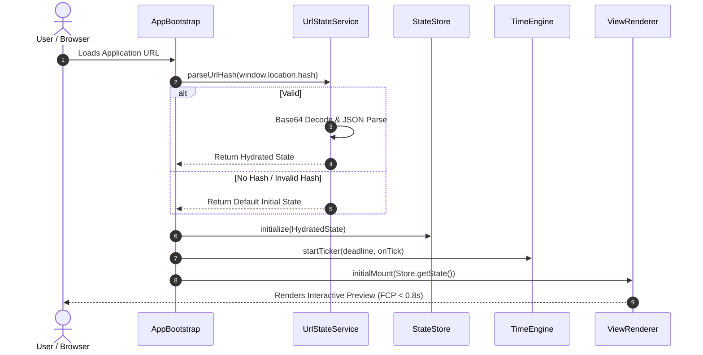
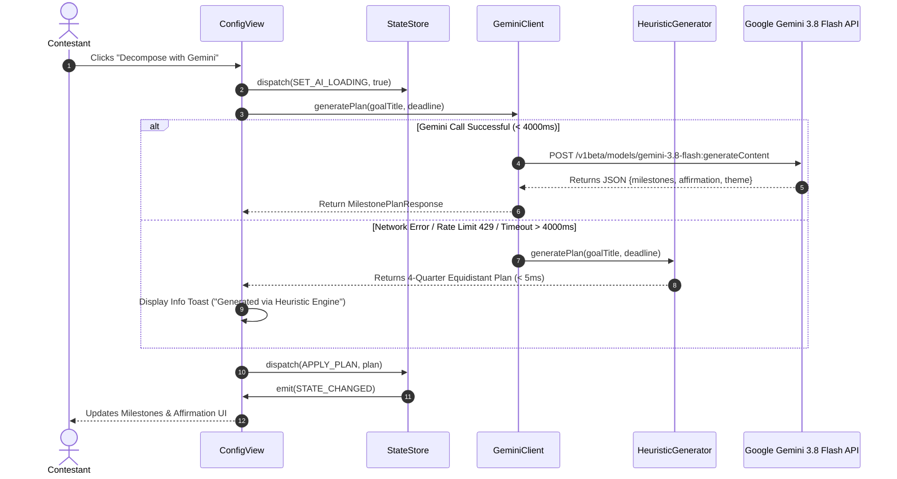
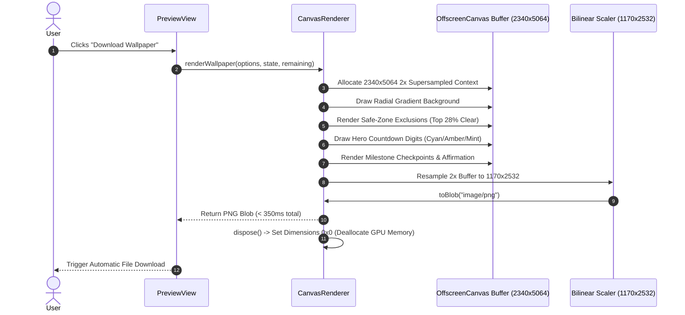
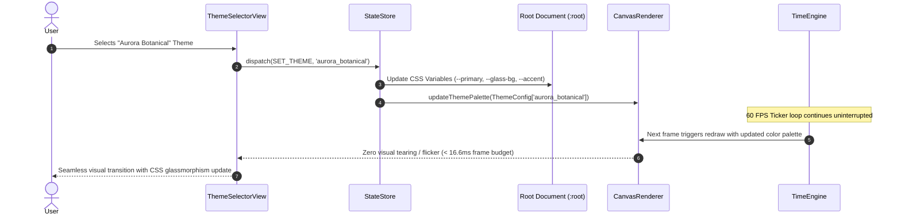
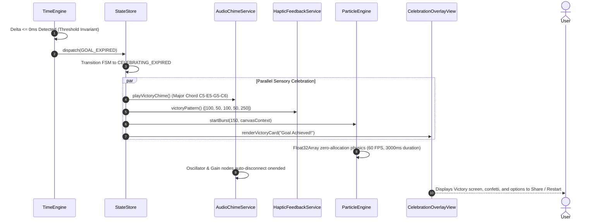
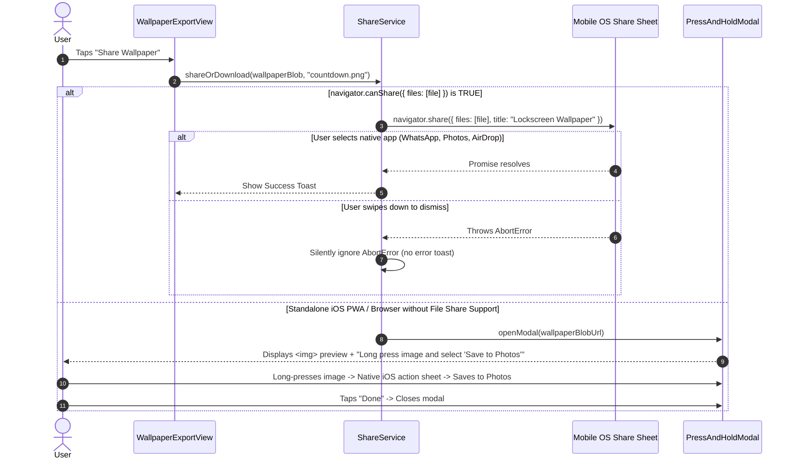
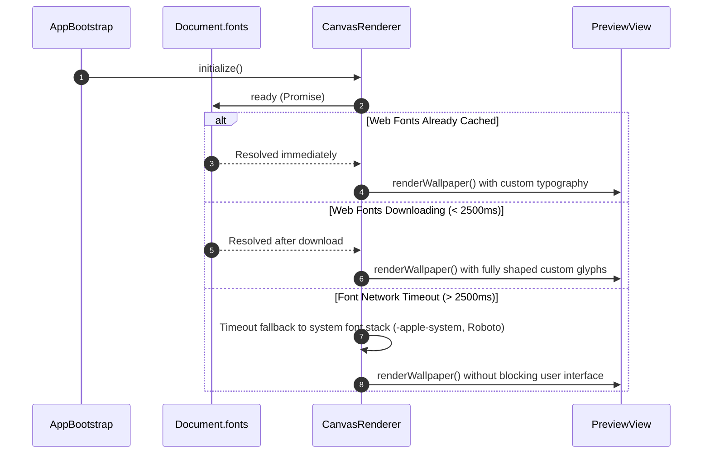
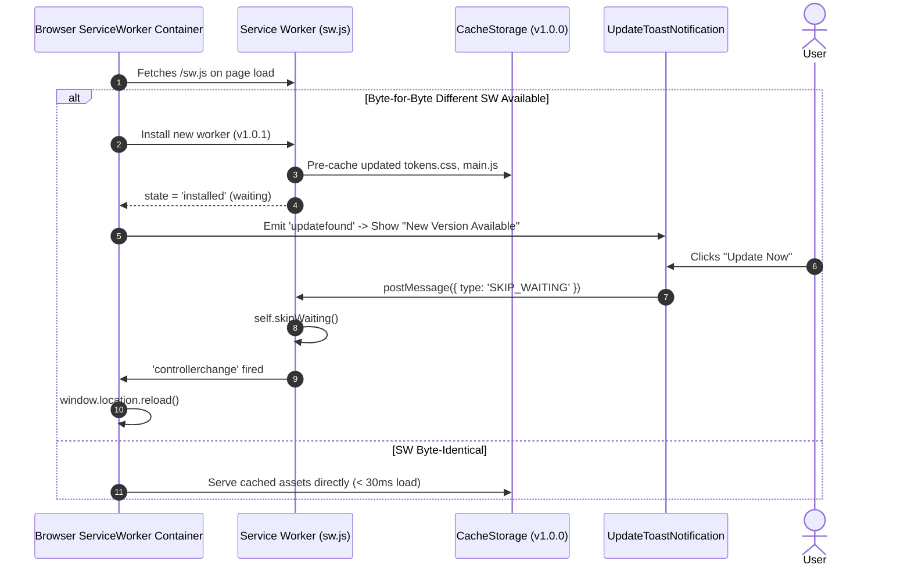

# Level 4: Low-Level Design — Dynamic Interaction Sequences

**Document ID:** `DOC-LLD-02-DYNAMIC-SEQUENCES`  
**Project:** `countdown-lockscreen-challenge`  
**Challenge:** Handshake AI Skills Studio X Google ("Your Deadline, Your Design: Create a Countdown Lock Screen")  
**Author:** Piyush Makhija (Lead Systems Architect & Developer)  
**Reviewer:** Architecture Review Board  
**Status:** APPROVED  
**Standard:** Level 2.2 Documentation Governance (Formal Dynamic Sequence Modeling)

---

## 1. Sequence 1: Application Ingress & URL State Hydration



---

## 2. Sequence 2: Google Gemini Planning with Immediate Heuristic Fallback



---

## 3. Sequence 3: Drift-Compensated Animation Frame Loop (60 FPS)

```mermaid
sequenceDiagram
    autonumber
    participant Ticker as TimeEngine
    participant RAF as Window.requestAnimationFrame
    participant Clock as Hardware Clock (performance.now)
    participant View as DOMTickerView

    Ticker->>RAF: requestAnimationFrame(step)
    RAF-->>Ticker: step(timestamp)
    Ticker->>Clock: Read Date.now() and performance.now()
    Ticker->>Ticker: Delta = targetEpoch - currentEpoch
    Ticker->>View: updateDigits(days, hours, minutes, seconds)
    alt Document Visible
        Ticker->>RAF: requestAnimationFrame(step) (Continuous 60 FPS)
    else Tab In Background
        Note over Ticker: Browser throttles RAF to 1 Hz; zero drift accumulates
    end
```

---

## 4. Sequence 4: High-DPI OffscreenCanvas Wallpaper Rasterization



---

## 5. Sequence 5: Dynamic Theme Switching Mid-Countdown (Zero Tearing)



---

## 6. Sequence 6: Goal Expiration, Audio Chime, Haptics & Confetti Burst



---

## 7. Sequence 7: URL Hash Synchronization with 300ms Leaky Bucket History Guard

```mermaid
sequenceDiagram
    autonumber
    actor User as User
    participant Input as GoalTitleInput
    participant Guard as HistoryQuotaGuard
    participant Router as UrlStateService
    participant Browser as Window.history

    User->>Input: Types "Launch Startup MVP" (Rapid Keystrokes)
    Input->>Guard: pushStateUpdate(serializedState) [Keystroke 1]
    Note over Guard: Timer started (300ms debounce window)
    User->>Input: Next Keystroke (t = 80ms)
    Input->>Guard: pushStateUpdate(serializedState) [Keystroke 2]
    Note over Guard: Previous timer cancelled; new 300ms window armed
    Note over Guard: No history.replaceState calls during typing burst!
    Note over Guard: 300ms elapse with no new keystrokes
    Guard->>Router: serialize(latestState)
    Router->>Browser: history.replaceState(null, '', '#v1=' + base64Payload)
    Note over Browser: Safari 100-call / 30s limit respected; zero SecurityError
```

---

## 8. Sequence 8: Web Share API Ingress with iOS Standalone Modal Fallback



---

## 9. Sequence 9: Canvas Web Font Loading Race Condition Resolution



---

## 10. Sequence 10: Service Worker Cache-First Lifecycle & In-App Update Prompt


