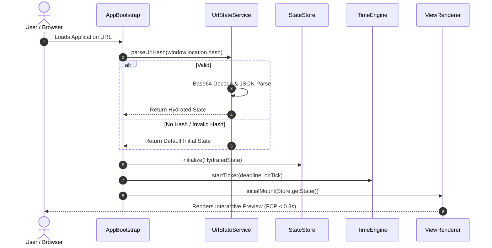
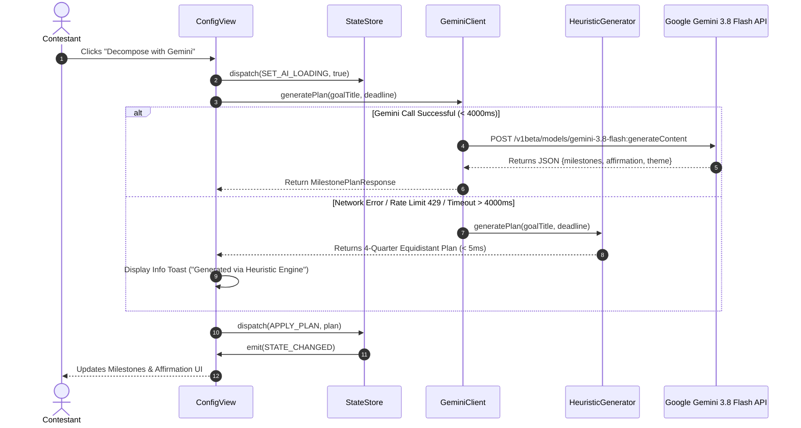
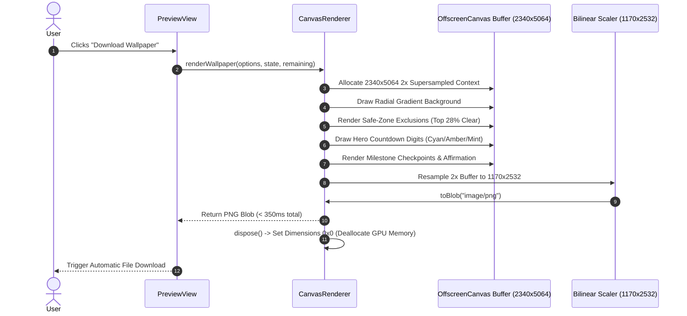

# Level 4: Low-Level Design — Dynamic Interaction Sequences

**Document ID:** `DOC-LLD-02-DYNAMIC-SEQUENCES`  
**Project:** `countdown-lockscreen-challenge`  
**Challenge:** Handshake AI Skills Studio X Google ("Your Deadline, Your Design: Create a Countdown Lock Screen")  
**Author:** Piyush Makhija (Lead Systems Architect & Developer)  
**Reviewer:** Architecture Review Board  
**Status:** APPROVED  
**Standard:** Level 2.3 Documentation Governance (Formal Dynamic Sequence Modeling)

---

## 1. Sequence 1: Application Ingress & URL State Hydration



---

## 2. Sequence 2: Google Gemini Planning with Immediate Heuristic Fallback



---

## 3. Sequence 3: Drift-Compensated Animation Frame Loop (60 FPS)

```mermaid
sequenceDiagram
    autonumber
    participant Ticker as TimeEngine
    participant RAF as Window.requestAnimationFrame
    participant Clock as Hardware Clock (performance.now)
    participant View as DOMTickerView

    Ticker->>RAF: requestAnimationFrame(step)
    RAF-->>Ticker: step(timestamp)
    Ticker->>Clock: Read Date.now() and performance.now()
    Ticker->>Ticker: Delta = targetEpoch - currentEpoch
    Ticker->>View: updateDigits(days, hours, minutes, seconds)
    alt Document Visible
        Ticker->>RAF: requestAnimationFrame(step) (Continuous 60 FPS)
    else Tab In Background
        Note over Ticker: Browser throttles RAF to 1 Hz; zero drift accumulates
    end
```

---

## 4. Sequence 4: High-DPI OffscreenCanvas Wallpaper Rasterization


