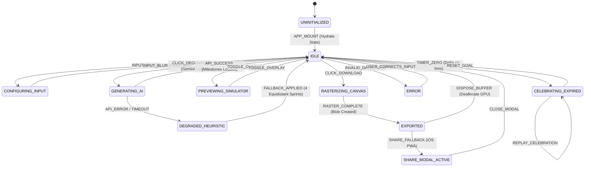

# Level 4: Low-Level Design — State Machine & Lifecycle Specification

**Document ID:** `DOC-LLD-03-STATE-MACHINE`  
**Project:** `countdown-lockscreen-challenge`  
**Challenge:** Handshake AI Skills Studio X Google ("Your Deadline, Your Design: Create a Countdown Lock Screen")  
**Author:** Piyush Makhija (Lead Systems Architect & Developer)  
**Reviewer:** Architecture Review Board  
**Status:** APPROVED  
**Standard:** Level 2.3 Documentation Governance (Formal Finite State Machine)

---

## 1. Formal FSM Mathematical Definition

The core application lifecycle is modeled as a deterministic **Finite State Machine (FSM)**:

$$M = (S, \Sigma, \delta, s_0, F)$$

Where:
- $S = \{\text{UNINITIALIZED}, \text{IDLE}, \text{CONFIGURING\_INPUT}, \text{GENERATING\_AI}, \text{DEGRADED\_HEURISTIC}, \text{PREVIEWING\_SIMULATOR}, \text{RASTERIZING\_CANVAS}, \text{EXPORTED}, \text{CELEBRATING\_EXPIRED}, \text{SHARE\_MODAL\_ACTIVE}, \text{ERROR}\}$
- $\Sigma$ is the set of user, timer, and system events.
- $\delta: S \times \Sigma \to S$ is the state transition function.
- $s_0 = \text{UNINITIALIZED}$ is the initial state.
- $F = \{\text{EXPORTED}, \text{CELEBRATING\_EXPIRED}, \text{IDLE}\}$ is the set of quiescent states.

---

## 2. State Transition Table

```
+-------------------------------------------------------------------------------------------------------------------+
|                                              STATE TRANSITION MATRIX                                              |
+-----------------------+--------------------------+-----------------------+----------------------------------------+
| Current State         | Ingress Event            | Next State            | Transition Side-Effect                 |
+-----------------------+--------------------------+-----------------------+----------------------------------------+
| `UNINITIALIZED`       | `APP_MOUNT`              | `IDLE`                | Parse URL hash, start Ticker           |
| `IDLE`                | `INPUT_FOCUS`            | `CONFIGURING_INPUT`   | Show soft keyboard, arm history guard  |
| `CONFIGURING_INPUT`   | `INPUT_BLUR`             | `IDLE`                | Flush pending URL hash to history      |
| `IDLE`                | `CLICK_DECOMPOSE_AI`     | `GENERATING_AI`       | Set loading spinner, call API          |
| `GENERATING_AI`       | `API_SUCCESS`            | `IDLE`                | Populate 3-5 milestones                |
| `GENERATING_AI`       | `API_TIMEOUT_OR_ERROR`   | `DEGRADED_HEURISTIC`  | Trigger HeuristicGenerator             |
| `DEGRADED_HEURISTIC`  | `FALLBACK_COMPLETE`      | `IDLE`                | Render 4-quarter milestones            |
| `IDLE`                | `TOGGLE_OVERLAY`         | `PREVIEWING_SIMULATOR`| Render iOS/Android SVG guides          |
| `PREVIEWING_SIMULATOR`| `TOGGLE_OVERLAY`         | `IDLE`                | Remove safe-zone guides                |
| `IDLE`                | `CLICK_DOWNLOAD`         | `RASTERIZING_CANVAS`  | Allocate 2x OffscreenCanvas            |
| `RASTERIZING_CANVAS`  | `RASTER_SUCCESS`         | `EXPORTED`            | Generate PNG Blob & trigger share/save |
| `EXPORTED`            | `SHARE_FALLBACK`         | `SHARE_MODAL_ACTIVE`  | Open "Press & Hold to Save" modal      |
| `SHARE_MODAL_ACTIVE`  | `CLOSE_MODAL`            | `IDLE`                | Dismiss modal, revoke Blob URL         |
| `EXPORTED`            | `DISPOSE_BUFFER`         | `IDLE`                | Free GPU memory, URL.revoke            |
| `IDLE`                | `TIMER_ZERO`             | `CELEBRATING_EXPIRED` | Play Web Audio chime, haptics, confetti|
| `CELEBRATING_EXPIRED` | `REPLAY_CELEBRATION`     | `CELEBRATING_EXPIRED` | Re-trigger audio chime & particles     |
| `CELEBRATING_EXPIRED` | `RESET_GOAL`             | `IDLE`                | Clear countdown, reset input fields    |
| Any State             | `CRITICAL_EXCEPTION`     | `ERROR`               | Show error toast & recovery            |
| `ERROR`               | `USER_CORRECTS_INPUT`    | `IDLE`                | Reset error state, revalidate fields   |
+-----------------------+--------------------------+-----------------------+----------------------------------------+
```

---

## 3. Mermaid State Diagram


