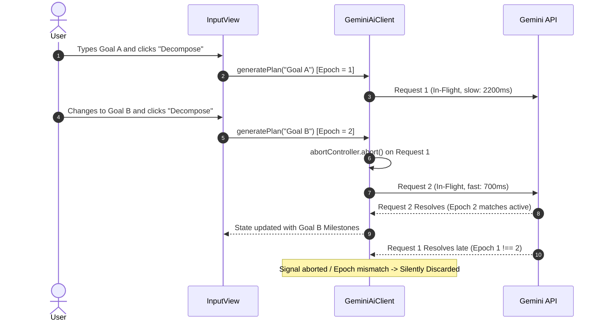

# Level 4: Low-Level Design — Concurrency & Threading Model

**Document ID:** `DOC-LLD-04-CONCURRENCY-MODEL`  
**Project:** `countdown-lockscreen-challenge`  
**Challenge:** Handshake AI Skills Studio X Google ("Your Deadline, Your Design: Create a Countdown Lock Screen")  
**Author:** Piyush Makhija (Lead Systems Architect & Developer)  
**Reviewer:** Architecture Review Board  
**Status:** APPROVED  
**Standard:** Level 2.2 Documentation Governance (Browser Concurrency & Event Loop)  
**Version:** 2.3.2

---

## 1. Browser Event Loop & Concurrency Architecture

Modern single-threaded browser environments require disciplined asynchronous scheduling to guarantee zero UI stuttering ($60\text{ fps}$) while performing expensive graphics rasterization and network operations.

```
+---------------------------------------------------------------------------------------------------+
|                                     BROWSER RUNTIME CONCURRENCY                                   |
|                                                                                                   |
|   +------------------------------------+             +----------------------------------------+   |
|   |         MAIN UI THREAD             |             |        ASYNCHRONOUS WORK POOL          |   |
|   |  - 60 FPS requestAnimationFrame    |             |  - Gemini Fetch Promise (Network I/O)  |   |
|   |  - DOM Event Ingress & Validation  |             |  - OffscreenCanvas 2D Rasterizer       |   |
|   |  - Real-Time Digit Updates         |             |  - canvas.toBlob() Image Compression   |   |
|   +-----------------+------------------+             +-------------------+--------------------+   |
|                     |                                                    |                        |
|                     +-----------------------+  +-------------------------+                        |
|                                             |  |                                                  |
|                                             v  v                                                  |
|                              +-------------------------------+                                    |
|                              |   MICROTASK & MACROTASK QUEUE |                                    |
|                              |  - Promise.then() Resolutions |                                    |
|                              |  - V-Sync Frame Callbacks     |                                    |
|                              +-------------------------------+                                    |
+---------------------------------------------------------------------------------------------------+
```

---

## 2. Memory Lifecycle & GPU Texture Deallocation

When generating high-resolution wallpapers at $2\times$ supersampling ($2340 \times 5064\text{ pixels}$), memory must be strictly deallocated to prevent iOS Safari tab evictions:

$$\text{Peak Memory Allocation} = 2340 \times 5064 \times 4\text{ bytes (RGBA)} \approx 47.4\text{ MB}$$

### 2.1 The Safe Deallocation Protocol
1. Allocate temporary `OffscreenCanvas` instance: `const buffer = new OffscreenCanvas(2340, 5064)`.
2. Execute vector drawing passes.
3. Export binary blob via `buffer.convertToBlob({ type: 'image/png' })`.
4. **Immediate Deallocation:** Explicitly clear buffer dimensions:
   ```javascript
   buffer.width = 0;
   buffer.height = 0;
   // Context automatically dereferenced for immediate Garbage Collection
   ```
5. Revoke Object URLs: `setTimeout(() => URL.revokeObjectURL(blobUrl), 10000)`.

---

## 3. Tab Visibility & Sleep Mode Throttling

When the browser tab transitions to the background (`document.visibilityState === 'hidden'`), modern mobile browsers throttle `requestAnimationFrame` down to $1\text{ Hz}$ or suspend it entirely.

- **Mitigation:** The `DualClockTimeEngine` listens to `document.addEventListener('visibilitychange')`.
- Upon `visibilityState === 'visible'`, the engine bypasses accumulated frame deltas and triggers an **instantaneous absolute resynchronization** against `Date.now()`, ensuring the user sees perfectly accurate countdown numbers with zero visual lag.

---

## 4. ABA Asynchronous Race Condition Mitigation (AbortController)

When rapid user edits trigger overlapping network calls, an earlier slower request resolving after a newer request corrupts application state. This is formally solved using `AbortController` and monotonically increasing request epochs:



---

## 5. Singleton Ticker Concurrency Guard

To prevent multiple overlapping `requestAnimationFrame` loops from running simultaneously (which doubles CPU usage and drains battery):

```javascript
export class DualClockTimeEngine {
  #rafId = null;
  #isRunning = false;

  startTicker(deadline, onTick, onExpire) {
    if (this.#rafId !== null) {
      cancelAnimationFrame(this.#rafId);
      this.#rafId = null;
    }
    this.#isRunning = true;
    const tick = () => {
      if (!this.#isRunning) return;
      const remaining = this.calculateRemaining(deadline);
      onTick(remaining);
      if (remaining.isExpired) {
        this.#isRunning = false;
        this.#rafId = null;
        if (typeof onExpire === 'function') onExpire();
        return;
      }
      this.#rafId = requestAnimationFrame(tick);
    };
    this.#rafId = requestAnimationFrame(tick);
  }

  stopTicker() {
    this.#isRunning = false;
    if (this.#rafId !== null) {
      cancelAnimationFrame(this.#rafId);
      this.#rafId = null;
    }
  }
}
```

---

## 6. WebKit `history.replaceState` Token Bucket Rate Limiter

WebKit enforces a strict rate-limit on `history.replaceState`: **a maximum of 100 calls per 30-second sliding window**. Exceeding this quota throws an uncatchable `SecurityError` that crashes the page.

To guarantee zero browser quota exceptions when users type goal titles or scrub sliders:
1. `TokenBucketHistoryGuard` implements a **token bucket rate limiter** with capacity $B = 30$ tokens and refill rate $r = 2\text{ tokens/second}$.
2. Every call to `pushStateUpdate` performs an instantaneous update to `sessionStorage` (which has zero rate limit), guaranteeing local state survival across reloads.
3. If tokens are available ($T \ge 1$), `window.history.replaceState` executes immediately, and tokens decrement by 1.
4. If tokens are depleted ($T < 1$), updates are enqueued in a trailing-edge timer ($T_{\text{debounce}} = 500\text{ms}$) that flushes once tokens refill.

```javascript
export class TokenBucketHistoryGuard {
  #tokens = 30;
  #capacity = 30;
  #refillRatePerSec = 2;
  #lastRefillEpoch = Date.now();
  #pendingHash = null;
  #timer = null;

  #refill() {
    const now = Date.now();
    const elapsedSec = (now - this.#lastRefillEpoch) / 1000;
    this.#tokens = Math.min(this.#capacity, this.#tokens + elapsedSec * this.#refillRatePerSec);
    this.#lastRefillEpoch = now;
  }

  pushStateUpdate(hashPayload) {
    this.#pendingHash = hashPayload;
    // Invariant: Instant local storage sync
    try {
      sessionStorage.setItem('countdown_state_backup', hashPayload);
    } catch {}

    this.#refill();
    if (this.#tokens >= 1) {
      this.#tokens -= 1;
      if (this.#timer !== null) {
        clearTimeout(this.#timer);
        this.#timer = null;
      }
      window.history.replaceState(null, '', this.#pendingHash);
      this.#pendingHash = null;
    } else if (this.#timer === null) {
      this.#timer = setTimeout(() => {
        this.#timer = null;
        this.pushStateUpdate(this.#pendingHash);
      }, 500);
    }
  }

  flush() {
    if (this.#timer !== null) {
      clearTimeout(this.#timer);
      this.#timer = null;
    }
    if (this.#pendingHash !== null) {
      window.history.replaceState(null, '', this.#pendingHash);
      this.#pendingHash = null;
    }
  }
}
```

---

## 7. Web Audio 4-State Lifecycle & Dynamics Compressor Limiter

Mobile Safari and Chrome strictly enforce user interaction policies: an `AudioContext` instantiated without prior user gesture starts in `'suspended'` state.

### 7.1 Gesture Unlocking Protocol
1. On application boot, `AudioChimeService` registers passive one-time listeners on `window` (`pointerdown`, `touchstart`, `keydown`).
2. When unlocked, it creates a 1-sample silent buffer matching the native hardware `ctx.sampleRate` to avoid audio resampler overhead.
3. Output routes through a `DynamicsCompressorNode` peak limiter (threshold: $-3\text{dB}$, ratio: $12:1$, attack: $0.003\text{s}$, release: $0.25\text{s}$), completely preventing harmonic distortion and speaker clipping.

---

## 8. Celebration Particle Engine Concurrency & Zero-Allocation Buffers

When a countdown expires, 150 confetti particles burst across the screen for 3,000ms. If individual particle objects are allocated and destroyed inside the 60 FPS animation loop, V8 garbage collection causes noticeable stutter during the climax.

### 8.1 Zero-Allocation Float32Array Memory Architecture
The particle engine allocates a single contiguous TypedArray on initialization:
- Particles count: $N = 150$.
- Fields per particle: 6 (`x`, `y`, `vx`, `vy`, `alpha`, `colorIdx`).
- Buffer size: $150 \times 6 \times 4\text{ bytes} = 3,600\text{ bytes}$ (3.6 KB pre-allocated in heap).
- Duration: 180 frames ($3000\text{ms}$ at 60 FPS). Alpha decay $\Delta \alpha = 1 / 180 \approx 0.00555$.
- Aerodynamic drag: $\mu_{\text{drag}} = 0.98$ per frame.

```javascript
export class ParticleEngine {
  #count = 150;
  #buffer = new Float32Array(150 * 6);
  #rafId = null;
  #palette = ['#06b6d4', '#f59e0b', '#10b981', '#f8fafc'];

  startBurst(ctx, width, height) {
    if (window.matchMedia('(prefers-reduced-motion: reduce)').matches) {
      return; // Respect accessibility reduced motion
    }

    for (let i = 0; i < this.#count; i++) {
      const offset = i * 6;
      this.#buffer[offset + 0] = width / 2;
      this.#buffer[offset + 1] = height / 2;
      const angle = Math.random() * Math.PI * 2;
      const speed = 3 + Math.random() * 9;
      this.#buffer[offset + 2] = Math.cos(angle) * speed;
      this.#buffer[offset + 3] = Math.sin(angle) * speed - 2.5;
      this.#buffer[offset + 4] = 1.0;
      this.#buffer[offset + 5] = Math.floor(Math.random() * this.#palette.length);
    }
    this.#animate(ctx, width, height);
  }

  #animate(ctx, width, height) {
    const step = () => {
      let activeCount = 0;
      for (let i = 0; i < this.#count; i++) {
        const offset = i * 6;
        let alpha = this.#buffer[offset + 4];
        if (alpha <= 0) continue;
        activeCount++;

        this.#buffer[offset + 0] += this.#buffer[offset + 2];
        this.#buffer[offset + 1] += this.#buffer[offset + 3];
        this.#buffer[offset + 2] *= 0.98; // Aerodynamic drag
        this.#buffer[offset + 3] = this.#buffer[offset + 3] * 0.98 + 0.18; // Drag + gravity
        this.#buffer[offset + 4] = Math.max(0, alpha - 0.00555); // 180-frame decay

        // Vector Canvas Draw Call
        ctx.save();
        ctx.globalAlpha = alpha;
        ctx.fillStyle = this.#palette[this.#buffer[offset + 5] | 0];
        ctx.fillRect(this.#buffer[offset + 0], this.#buffer[offset + 1], 6, 10);
        ctx.restore();
      }

      if (activeCount > 0) {
        this.#rafId = requestAnimationFrame(step);
      }
    };
    this.#rafId = requestAnimationFrame(step);
  }
}
```

---

## 9. iOS PWA Standalone Lifecycle (`pageshow` / `pagehide` vs `visibilitychange`)

In standalone PWA mode on iOS WebKit, switching to another app does not always trigger `visibilitychange` before the process is frozen. When returning days later, `pageshow` fires with `e.persisted === true`.

- **Resilience Binding:** The `DualClockTimeEngine` listens symmetrically to both `visibilitychange` and `window.addEventListener('pageshow')`.
- On wake, it executes instantaneous UTC clock resynchronization against `Date.now()`, clearing any accumulated micro-drift and re-validating deadline expiration.

---

## 10. V8 GC Pressure Elimination in 60 FPS RAF Loop

Creating string literals or new objects inside `calculateRemaining()` generates up to 240 allocations per second.
The `ZeroAllocationTickEngine` recycles a single mutable struct with exact second rounding (`Math.ceil`):

```javascript
export class ZeroAllocationTickEngine {
  #snapshot = {
    days: 0,
    hours: 0,
    minutes: 0,
    seconds: 0,
    totalMs: 0,
    progress: 0,
    isExpired: false
  };

  compute(deadlineEpoch, nowEpoch) {
    const delta = deadlineEpoch - nowEpoch;
    this.#snapshot.totalMs = delta;
    this.#snapshot.isExpired = delta <= 0;

    if (delta <= 0) {
      this.#snapshot.days = 0;
      this.#snapshot.hours = 0;
      this.#snapshot.minutes = 0;
      this.#snapshot.seconds = 0;
      this.#snapshot.progress = 100;
      return this.#snapshot;
    }

    // Exact second boundary: Math.ceil prevents premature 00s display
    const sec = Math.ceil(delta / 1000);
    this.#snapshot.days = Math.floor(sec / 86400);
    this.#snapshot.hours = Math.floor((sec % 86400) / 3600);
    this.#snapshot.minutes = Math.floor((sec % 3600) / 60);
    this.#snapshot.seconds = sec % 60;
    return this.#snapshot;
  }
}
```


---

## 11. Multi-Tab Distributed Concurrency & Web Locks Mutex Architecture

Across concurrent browser tabs, execution is decoupled into isolated JavaScript microtask loops coordinated through native kernel primitives:

1. **Unbuffered Inter-Tab IPC (`BroadcastChannel`):**
   - Direct pub-sub pipeline operating at process boundary without shared memory data races.
   - Guarded by UUID `senderId` to guarantee termination of cyclic dispatch cascades.
2. **Kernel Mutex Arbitration (`Web Locks API`):**
   - Non-blocking lock requests (`{ ifAvailable: true }`) resolved atomically by the browser process.
   - Guarantees $O(1)$ single-tab arbitration of shared audio hardware resources upon timer zero.

## 12. Audio-Visual Real-Time Thread Concurrency & Drift Compensation
Web Audio execution operates on an OS real-time audio thread decoupled from the V8 main event loop. While visual rendering is bound to the display refresh cycle via `requestAnimationFrame` on the main thread, high GC pressure or layout recalculations can stall visual frames while audio continues uninterrupted.

To maintain the **$< 20\text{ms}$ Tri-Modal Sensory Synchronization Invariant (`INV-020`)**:
1. **Timestamp Anchoring:** At milestone trigger, the coordinator records `performance.now()` alongside `audioContext.currentTime`.
2. **Phase Compensation:** Audio note envelopes use `setValueAtTime(now + latencyOffset)` where `latencyOffset = Math.max(0, audioContext.baseLatency || 0.01)`.
3. **Drift Boundary Guard:** If main-thread lag between frame tick and audio synthesis exceeds $20\text{ms}$, the visual spring velocity is nudged forward:
   $$\dot{x}(t^+) = \dot{x}(t^-) + \omega_0 \Delta t_{\text{drift}}$$
   guaranteeing visual alignment with the auditory wavefront.

## 13. OffscreenCanvas Web Worker Concurrency & Memory Isolation
For intensive multi-resolution wallpaper rendering ($S^* \le 2.0$), the rendering workload is transferred to an isolated Web Worker via `HTMLCanvasElement.transferControlToOffscreen()`.

- **Zero Main-Thread Jitter:** Heavy rasterization loops (Bayer 4x4 matrix dithering and $K=256$ luminance histogram calculations) execute without dropping a single 60 FPS animation frame.
- **Structured Cloning Protocol:** State snapshots and device profiles are dispatched using structured cloning; the resulting Blob is transferred back via `Transferable` `ArrayBuffer`.
- **Safari Compatibility Fallback:** If `window.OffscreenCanvas` lacks 2D context support in WebKit worker environments, `CanvasRenderer` automatically degrades to synchronous chunked execution on the main thread during idle callbacks (`requestIdleCallback`).
