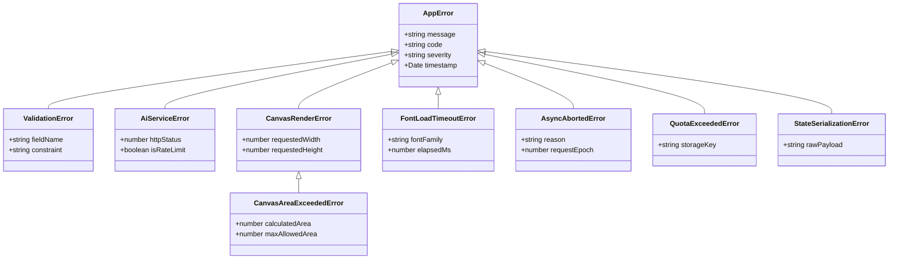

# Level 4: Low-Level Design — Exception Hierarchy & Error Handling

**Document ID:** `DOC-LLD-06-EXCEPTION-HIERARCHY`  
**Project:** `countdown-lockscreen-challenge`  
**Challenge:** Handshake AI Skills Studio X Google ("Your Deadline, Your Design: Create a Countdown Lock Screen")  
**Author:** Piyush Makhija (Lead Systems Architect & Developer)  
**Reviewer:** Architecture Review Board  
**Status:** APPROVED  
**Standard:** Level 2.3 Documentation Governance (Robust Exception Hierarchy)

---

## 1. Domain Exception Hierarchy

Adhering to `~/.claude/rules/19-exception-handling-hierarchy.md`, all errors inherit from a base `AppError` carrying machine-readable codes and severity levels:



---

## 2. Error Catalogue & Recovery Actions

```
+---------------------------------------------------------------------------------------------------------+
|                                        EXCEPTION RECOVERY CATALOGUE                                     |
+-----------------------+--------------------+-----------------------+------------------------------------+
| Error Class           | Error Code         | Root Cause            | Automated Recovery Strategy        |
+-----------------------+--------------------+-----------------------+------------------------------------+
| `ValidationError`     | `ERR_PAST_DATE`    | Deadline in the past  | Rejects input; displays date hint. |
| `ValidationError`     | `ERR_TITLE_EMPTY`  | Goal string is blank  | Sets focus to goal input field.    |
| `AiServiceError`      | `ERR_AI_TIMEOUT`   | Gemini latency >4000ms| Automatically falls back to        |
|                       |                    |                       | HeuristicGenerator without error.  |
| `AiServiceError`      | `ERR_AI_HTTP_429`  | Quota exceeded        | Trips circuit breaker; falls back. |
| `CanvasRenderError`   | `ERR_CANVAS_OOM`   | Memory allocation fail| Retries at native 1x resolution.   |
| `CanvasAreaExceeded`  | `ERR_CANVAS_CEIL`  | Area > 16.7M pixels   | Auto-clamps DPR to 2.0x max.       |
| `FontLoadTimeoutError`| `ERR_FONT_TIMEOUT` | Web font load > 2500ms | Falls back to system sans-serif.   |
| `AsyncAbortedError`   | `ERR_ASYNC_ABORT`  | Request superceded    | Silently discards stale response.  |
| `QuotaExceededError`  | `ERR_STORAGE_FULL` | LocalStorage quota    | Falls back to in-memory transient. |
| `StateSerialization`  | `ERR_HASH_CORRUPT` | Invalid Base64 payload| Logs warning; loads default state. |
+-----------------------+--------------------+-----------------------+------------------------------------+
```
