# Level 4: Low-Level Design — Exception Hierarchy & Error Handling

**Document ID:** `DOC-LLD-06-EXCEPTION-HIERARCHY`  
**Project:** `countdown-lockscreen-challenge`  
**Challenge:** Handshake AI Skills Studio X Google ("Your Deadline, Your Design: Create a Countdown Lock Screen")  
**Author:** Piyush Makhija (Lead Systems Architect & Developer)  
**Reviewer:** Architecture Review Board  
**Status:** APPROVED  
**Standard:** Level 2.2 Documentation Governance (Robust Exception Hierarchy)

---

## 1. Domain Exception Hierarchy

Adhering to `~/.claude/rules/19-exception-handling-hierarchy.md`, all errors inherit from a base `AppError` carrying machine-readable codes and severity levels:

```mermaid
classDiagram
    class AppError {
        +string message
        +string code
        +string severity
        +Date timestamp
    }
    class ValidationError {
        +string fieldName
        +string constraint
    }
    class AiServiceError {
        +number httpStatus
        +boolean isRateLimit
    }
    class AiSafetyBlockError {
        +string blockReason
        +string safetyRating
    }
    class CanvasRenderError {
        +number requestedWidth
        +number requestedHeight
    }
    class CanvasAreaExceededError {
        +number calculatedArea
        +number maxAllowedArea
    }
    class FontLoadTimeoutError {
        +string fontFamily
        +number elapsedMs
    }
    class AsyncAbortedError {
        +string reason
        +number requestEpoch
    }
    class QuotaExceededError {
        +string storageKey
    }
    class StateSerializationError {
        +string rawPayload
    }
    class PayloadTooLargeError {
        +number payloadLength
        +number maxLimit
    }
    class DecompressionBombError {
        +number decompressedBytes
        +number ceilingLimit
    }
    class AudioAutoplayBlockedError {
        +string audioState
    }
    class HistoryThrottledError {
        +number callsPerWindow
    }
    class ClipboardPermissionError {
        +string permissionState
    }
    class WebShareDismissedError {
        +boolean userInitiated
    }
    class Context2DUnavailableError {
        +string canvasId
    }
    class StateMutationError {
        +string actionType
    }
    class CyclicDispatchError {
        +number depth
    }
    class FontLoadError {
        +string fontSpec
    }

    AppError <|-- ValidationError
    AppError <|-- AiServiceError
    AiServiceError <|-- AiSafetyBlockError
    AppError <|-- CanvasRenderError
    CanvasRenderError <|-- CanvasAreaExceededError
    CanvasRenderError <|-- Context2DUnavailableError
    AppError <|-- FontLoadTimeoutError
    AppError <|-- FontLoadError
    AppError <|-- AsyncAbortedError
    AppError <|-- QuotaExceededError
    AppError <|-- StateSerializationError
    StateSerializationError <|-- PayloadTooLargeError
    StateSerializationError <|-- DecompressionBombError
    AppError <|-- AudioAutoplayBlockedError
    AppError <|-- HistoryThrottledError
    AppError <|-- ClipboardPermissionError
    AppError <|-- WebShareDismissedError
    AppError <|-- StateMutationError
    StateMutationError <|-- CyclicDispatchError
```



---

## 2. Error Catalogue & Recovery Actions

```
+---------------------------------------------------------------------------------------------------------------+
|                                            EXCEPTION RECOVERY CATALOGUE                                       |
+-------------------------+--------------------------+-----------------------+----------------------------------+
| Error Class             | Error Code               | Root Cause            | Automated Recovery Strategy      |
+-------------------------+--------------------------+-----------------------+----------------------------------+
| `ValidationError`       | `ERR_PAST_DATE`          | Deadline in past      | Rejects input; displays hint.    |
| `ValidationError`       | `ERR_TITLE_EMPTY`        | Goal string is blank  | Sets focus to goal input field.  |
| `ValidationError`       | `ERR_TITLE_LENGTH`       | Length not in 3..60   | Inline helper shows char count.  |
| `ValidationError`       | `ERR_TITLE_INVALID_CHARS`| Forbidden HTML/script | Strips tags, prompts clean input.|
| `AiServiceError`        | `ERR_AI_TIMEOUT`         | Gemini latency >4000ms| Falls back to HeuristicGenerator.|
| `AiServiceError`        | `ERR_AI_HTTP_429`        | Quota exceeded        | Trips circuit breaker; fallback. |
| `AiSafetyBlockError`    | `ERR_AI_SAFETY_BLOCK`    | Harm safety filter hit| Generates safe fallback plan.    |
| `CanvasRenderError`     | `ERR_CANVAS_OOM`         | Memory allocation fail| Retries at native 1x resolution. |
| `CanvasAreaExceeded`    | `ERR_CANVAS_CEIL`        | Area > 16.7M pixels   | Auto-clamps DPR to 2.0x max.     |
| `Context2DUnavailable`  | `ERR_NO_CTX_2D`          | Mobile GPU crash/null | Prompts user to refresh tab.     |
| `FontLoadTimeoutError`  | `ERR_FONT_TIMEOUT`       | Web font load > 2500ms| Falls back to system sans-serif. |
| `AsyncAbortedError`     | `ERR_ASYNC_ABORT`        | Request superceded    | Silently discards stale response.|
| `QuotaExceededError`    | `ERR_STORAGE_FULL`       | LocalStorage quota    | Falls back to in-memory store.   |
| `StateSerialization`    | `ERR_HASH_CORRUPT`       | Invalid Base64 payload| Logs warning; loads demo goal.   |
| `PayloadTooLargeError`  | `ERR_PAYLOAD_TOO_LARGE`  | URL hash > 2048 chars | Rejects hash; notifies user.     |
| `DecompressionBombError`| `ERR_DECOMPRESSION_BOMB` | Payload > 32KB decoded| Blocks decompression immediately.|
| `AudioAutoplayBlocked`  | `ERR_AUDIO_LOCKED`       | No prior gesture      | Arms one-time click listener.    |
| `HistoryThrottled`      | `ERR_HIST_THROTTLE`      | > 30 calls in burst   | Queues state in Token Bucket.    |
| `ClipboardPermission`   | `ERR_CLIP_DENIED`        | Focus-less copy fail  | Falls back to manual selection.  |
| `WebShareDismissed`     | `ERR_SHARE_ABORT`        | User swiped down sheet| Silently dismissed; no toast.    |
| `StateMutationError`    | `ERR_STATE_FROZEN`       | Direct state property | Throws in strict mode; enforces UDF.|
| `CyclicDispatchError`   | `ERR_STATE_CYCLIC_DISPATCH`| Re-entrancy depth >10| Breaks cyclic action cascade.    |
| `FontLoadError`         | `ERR_FONT_LOAD_FAILED`   | Missing font file 404 | Employs fallback metric scaling. |
+-------------------------+--------------------------+-----------------------+----------------------------------+
```
