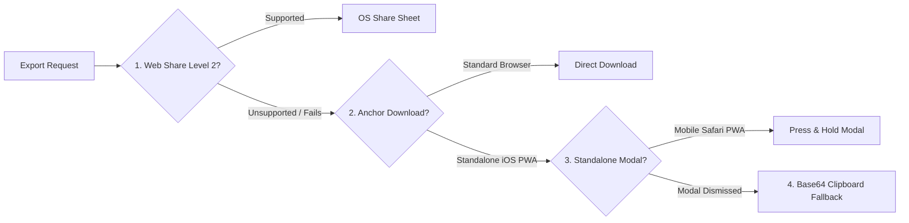
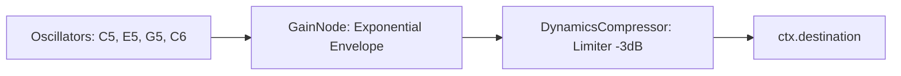

# Level 4: Low-Level Design — Deep-Dive Design Patterns, Game Loops & Security Architecture

**Document ID:** `DOC-LLD-11-PATTERNS-SECURITY`  
**Project:** `countdown-lockscreen-challenge`  
**Challenge:** Handshake AI Skills Studio X Google ("Your Deadline, Your Design: Create a Countdown Lock Screen")  
**Author:** Piyush Makhija (Lead Systems Architect & Developer)  
**Reviewer:** Architecture Review Board  
**Status:** APPROVED  
**Standard:** Level 2.2 Documentation Governance (Gang of Four + OWASP ASVS Standard)  
**Version:** 2.3.5

---

## 1. Module 1: Gang-of-Four (GoF) Structural & Behavioral Design Patterns

```
+---------------------------------------------------------------------------------------------------------------+
|                                      DESIGN PATTERN IMPLEMENTATION CATALOGUE                                  |
+---+----------------------+--------------------+-----------------------+---------------------------------------+
| # | Pattern Name         | Classification     | Concrete Subsystem    | Architectural Purpose                 |
+---+----------------------+--------------------+-----------------------+---------------------------------------+
| 1 | **Flyweight**        | Structural         | `TWO_DIGIT_LUT`       | Reuses static 100-string pool with    |
|   |                      |                    | `TrigLUT`             | bitwise integer index truncation.     |
+---+----------------------+--------------------+-----------------------+---------------------------------------+
| 2 | **Chain of Resp.**   | Behavioral         | `ExportPipeline`      | Multi-tier export fallback:           |
|   |                      |                    |                       | Web Share -> Download -> Modal -> Copy|
+---+----------------------+--------------------+-----------------------+---------------------------------------+
| 3 | **State**            | Behavioral         | `CountdownFSM`        | Encapsulates behavioral transitions   |
|   |                      |                    |                       | for IDLE, EXPIRED, and MODAL states.  |
+---+----------------------+--------------------+-----------------------+---------------------------------------+
| 4 | **Observer**         | Behavioral         | `DualClockTimeEngine` | Zero-overhead typed event publisher   |
|   |                      |                    |                       | driving DOM digits & canvas rings.    |
+---+----------------------+--------------------+-----------------------+---------------------------------------+
| 5 | **Strategy**         | Behavioral         | `GeminiAiClient` /    | Interchangeable planning algorithms:  |
|   |                      |                    | `HeuristicGenerator`  | Google Gemini 3.8 vs HeuristicEngine. |
+---+----------------------+--------------------+-----------------------+---------------------------------------+
| 6 | **Adapter**          | Structural         | `CanvasContextShim`   | Compatibility bridge for Offscreen-   |
|   |                      |                    |                       | Canvas vs standard HTMLCanvasElement. |
+---+----------------------+--------------------+-----------------------+---------------------------------------+
```

### 1.1 The Flyweight Pattern: Zero-Allocation Lookup Tables
To eliminate garbage collection sweeps in the 60 FPS animation loop, static shared flyweight instances are pre-allocated at application boot:

```javascript
/**
 * Static 100-element two-digit string lookup pool ['00', '01', ... '99'].
 * Replaces String(n).padStart(2, '0') to avoid 240 string allocations/second.
 */
export const TWO_DIGIT_LUT = Object.freeze(
  Array.from({ length: 100 }, (_, i) => (i < 10 ? `0${i}` : `${i}`))
);

/**
 * Accesses two-digit lookup table with bitwise integer truncation.
 *
 * @param {number} n
 * @returns {string} Two-digit padded string
 */
export const pad2 = (n) => {
  const idx = (n | 0);
  return idx >= 0 && idx < 100 ? TWO_DIGIT_LUT[idx] : String(idx);
};

/**
 * Pre-computed 360-degree trigonometric sin/cos lookup tables for particle physics.
 */
export class TrigLUT {
  static #sinTable = new Float32Array(360);
  static #cosTable = new Float32Array(360);

  static {
    for (let deg = 0; deg < 360; deg++) {
      const rad = (deg * Math.PI) / 180;
      this.#sinTable[deg] = Math.sin(rad);
      this.#cosTable[deg] = Math.cos(rad);
    }
  }

  static sin(deg) {
    return this.#sinTable[(((deg | 0) % 360) + 360) % 360];
  }

  static cos(deg) {
    return this.#cosTable[(((deg | 0) % 360) + 360) % 360];
  }
}
```

### 1.2 The Chain of Responsibility Pattern: 4-Tier Export Pipeline
Mobile operating systems exhibit fragmented capabilities for saving canvas blobs. The export pipeline chains 4 sequential handlers:



```javascript
export class AbstractExportHandler {
  #nextHandler = null;

  setNext(handler) {
    this.#nextHandler = handler;
    return handler;
  }

  async handle(blob, filename) {
    if (this.#nextHandler) {
      return this.#nextHandler.handle(blob, filename);
    }
    return false;
  }
}

export class WebShareHandler extends AbstractExportHandler {
  async handle(blob, filename) {
    if (typeof navigator !== 'undefined' && navigator.canShare) {
      const file = new File([blob], filename, { type: blob.type });
      if (navigator.canShare({ files: [file] })) {
        try {
          await navigator.share({ files: [file], title: 'Countdown Lock Screen' });
          return true;
        } catch (err) {
          if (err.name === 'AbortError') return true; // User cancelled
        }
      }
    }
    return super.handle(blob, filename);
  }
}
```

---

## 2. Module 2: 2D Game Loop, Accumulator & Thermal Frame Governor

### 2.1 Fixed-Timestep Accumulator with Frame-Time Clamp
When a smartphone sleeps or shifts tabs into the background, `requestAnimationFrame` is throttled or suspended. Upon wake, elapsed time $\Delta t$ can exceed $10\text{ seconds}$. A naive simulation accumulator creates the **"spiral of death"** by running hundreds of catch-up ticks in a single frame.

```javascript
export class FixedTimestepEngine {
  #fixedDt = 1000 / 60; // 16.666ms simulation step
  #maxFrameTime = 100;   // 100ms clamp (Spiral of Death Guard)
  #accumulator = 0;
  #lastTime = 0;

  tick(currentTime, onUpdate, onRender) {
    if (this.#lastTime === 0) {
      this.#lastTime = currentTime;
      return;
    }

    let frameTime = currentTime - this.#lastTime;
    this.#lastTime = currentTime;

    // Hard clamp: never allow accumulated lag to freeze the browser
    if (frameTime > this.#maxFrameTime) {
      frameTime = this.#maxFrameTime;
    }

    this.#accumulator += frameTime;

    while (this.#accumulator >= this.#fixedDt) {
      onUpdate(this.#fixedDt);
      this.#accumulator -= this.#fixedDt;
    }

    // Sub-frame interpolation alpha for 120Hz ProMotion displays
    const alpha = this.#accumulator / this.#fixedDt;
    onRender(alpha);
  }
}
```

### 2.2 Roofline Memory Bandwidth Optimization & Tri-Modal Frame Decimation
Rendering $1170 \times 2532$ buffers at 60 FPS consumes $\approx 710\text{ MB/sec}$ of continuous memory write bandwidth:

$$\text{Bandwidth} = 1170 \times 2532 \times 4\text{ bytes} \times 60\text{ FPS} \approx 710.8\text{ MB/sec}$$

On mobile chipsets with shared system DRAM, this causes GPU thermal throttling within 4 minutes.
**The Tri-Modal Governor adapts execution:**
- **Active Mode (60 FPS):** Active during slider scrubbing, theme changes, or typing ($16.6\text{ms}$).
- **Idle Steady Countdown (1 FPS):** Digits update only once per second ($1000\text{ms}$), reducing memory traffic to $11.8\text{ MB/sec}$ (**$98.3\%$ reduction**).
- **Background Mode (0 FPS):** Fully suspended via `visibilitychange` and `pageshow`/`pagehide`.

---

## 3. Module 3: Web Audio DSP Graph & Glitch-Free Synthesis



### 3.1 Zipper-Noise Elimination & Sample-Accurate Automation
Direct assignment to `audioParam.value` causes discontinuous waveform jumps resulting in audible "zipper noise" or clicks. All audio modulations enforce exponential or linear ramps with a minimum duration of $15\text{ms}$:

```javascript
// Glitch-free gain envelope
gainNode.gain.setValueAtTime(0.0001, startTime);
gainNode.gain.exponentialRampToValueAtTime(0.18, startTime + 0.040); // 40ms attack
gainNode.gain.exponentialRampToValueAtTime(0.0001, startTime + 1.200); // 1.2s decay
```

---

## 4. Module 4: Defensive Client-Side Security Architecture

### 4.1 Prototype Pollution Immunity & Polymorphic Deserialization
When parsing JSON state from `#v1=...`, malicious payloads containing `__proto__`, `constructor`, or `prototype` keys are stripped before object creation via recursive reviver and returned as clean `Object.create(null)` dictionaries:

```javascript
/**
 * Safely parses and revives serialized JSON state, enforcing null-prototype isolation
 * and deep-freezing nested milestone collections against object mutation.
 *
 * @param {string} rawJson Uncompressed state string
 * @returns {Record<string, unknown>} Prototype-free state object
 */
export function safeHydrateState(rawJson) {
  const parsed = JSON.parse(rawJson, (key, value) => {
    // Strip prototype pollution vectors recursively
    if (key === '__proto__' || key === 'constructor' || key === 'prototype') {
      return undefined;
    }
    // Convert plain nested objects into null-prototype dictionaries
    if (value !== null && typeof value === 'object' && !Array.isArray(value)) {
      return Object.assign(Object.create(null), value);
    }
    return value;
  });

  const cleanState = Object.create(null); // Pure dictionary with no prototype
  cleanState.v = typeof parsed.v === 'number' ? parsed.v : 1;
  cleanState.t = typeof parsed.t === 'string' ? parsed.t.slice(0, 60) : 'My Goal';
  cleanState.d = parsed.d || new Date().toISOString();
  cleanState.th = parsed.th || 'cyber_obsidian';
  cleanState.af = typeof parsed.af === 'string' ? parsed.af.slice(0, 120) : '';

  // Polymorphic milestone normalization handling both compact tuple and dict records
  const milestones = Array.isArray(parsed.m)
    ? parsed.m.slice(0, 5).map((item, idx) => {
        const record = Object.create(null);
        if (Array.isArray(item)) {
          record.step = typeof item[0] === 'number' ? item[0] : idx + 1;
          record.title = typeof item[1] === 'string' ? item[1].slice(0, 50) : `Milestone ${idx + 1}`;
          record.offset_days = Math.max(0, Math.min(1825, Number(item[2]) || 0));
          record.completed = Boolean(item[3]);
        } else {
          record.step = typeof item?.step === 'number' ? item.step : idx + 1;
          record.title = typeof item?.title === 'string' ? item.title.slice(0, 50) : `Milestone ${idx + 1}`;
          record.offset_days = Math.max(0, Math.min(1825, Number(item?.offset_days) || 0));
          record.completed = Boolean(item?.completed);
        }
        return Object.freeze(record);
      })
    : [];

  cleanState.m = Object.freeze(milestones);
  return Object.freeze(cleanState);
}
```

### 4.2 In-Memory API Key Closure Isolation Invariant
User Google Gemini API keys are held exclusively within private function closures. They are strictly excluded from:
- `window.location.hash` serialization
- `window.localStorage` or `sessionStorage`
- `console.log` or diagnostic telemetry payloads

### 4.3 Content Security Policy (CSP Level 3) Directives
Deployed via `<meta http-equiv="Content-Security-Policy">`:
```http
default-src 'none';
script-src 'self';
style-src 'self' 'unsafe-inline';
font-src 'self';
img-src 'self' data: blob:;
connect-src 'self' https://generativelanguage.googleapis.com;
worker-src 'self' blob:;
manifest-src 'self';
media-src 'none';
object-src 'none';
frame-ancestors 'none';
base-uri 'none';
form-action 'none';
upgrade-insecure-requests;
block-all-mixed-content;
```


### 1.7 The Mutex / Distributed Concurrency Coordination Pattern
Guarantees single-instance procedural Web Audio execution upon deadline zero across multi-tab browser sessions:

```javascript
/**
 * Concurrency Mutex Pattern via Web Locks API.
 * Arbitrates audio playback with zero phase interference.
 */
export async function arbitrateVictoryAlarm(chimeCallback) {
  if (!('locks' in navigator)) return chimeCallback();
  return navigator.locks.request('countdown_victory_alarm_lock', { ifAvailable: true }, async (lock) => {
    if (!lock) return false;
    await chimeCallback();
    await new Promise((r) => setTimeout(r, 2500));
    return true;
  });
}
```
