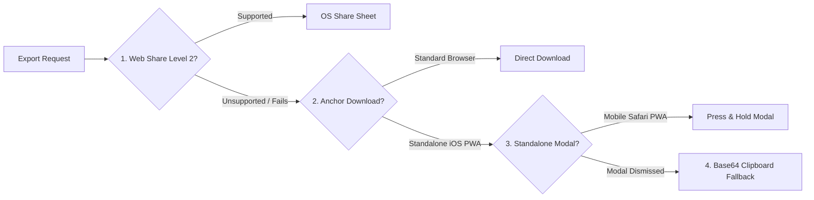
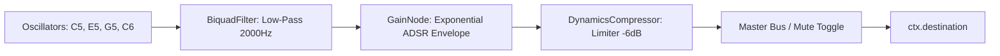

# Level 4: Low-Level Design — Deep-Dive Design Patterns, Game Loops & Security Architecture

**Document ID:** `DOC-LLD-11-PATTERNS-SECURITY`  
**Project:** `countdown-lockscreen-challenge`  
**Challenge:** Handshake AI Skills Studio X Google ("Your Deadline, Your Design: Create a Countdown Lock Screen")  
**Author:** Piyush Makhija (Lead Systems Architect & Developer)  
**Reviewer:** Architecture Review Board  
**Status:** APPROVED  
**Standard:** Level 2.3 Documentation Governance (Gang of Four + OWASP ASVS Standard)  

---

## 1. Module 1: Gang-of-Four (GoF) Structural & Behavioral Design Patterns

```
+---------------------------------------------------------------------------------------------------------------+
|                                      DESIGN PATTERN IMPLEMENTATION CATALOGUE                                  |
+---+----------------------+--------------------+-----------------------+---------------------------------------+
| # | Pattern Name         | Classification     | Concrete Subsystem    | Architectural Purpose                 |
+---+----------------------+--------------------+-----------------------+---------------------------------------+
| 1 | **Flyweight**        | Structural         | `TWO_DIGIT_LUT`       | Reuses static 100-string pool &       |
|   |                      |                    | `TrigLUT`             | 360-element sin/cos float tables.     |
+---+----------------------+--------------------+-----------------------+---------------------------------------+
| 2 | **Chain of Resp.**   | Behavioral         | `ExportPipeline`      | Multi-tier export fallback:           |
|   |                      |                    |                       | Web Share -> Download -> Modal -> Copy|
+---+----------------------+--------------------+-----------------------+---------------------------------------+
| 3 | **State**            | Behavioral         | `CountdownFSM`        | Encapsulates behavioral transitions   |
|   |                      |                    |                       | for IDLE, EXPIRED, and MODAL states.  |
+---+----------------------+--------------------+-----------------------+---------------------------------------+
| 4 | **Observer**         | Behavioral         | `TimeEngine`          | Zero-overhead typed event publisher   |
|   |                      |                    |                       | driving DOM digits & canvas rings.    |
+---+----------------------+--------------------+-----------------------+---------------------------------------+
| 5 | **Strategy**         | Behavioral         | `IMilestonePlanner`   | Interchangeable planning algorithms:  |
|   |                      |                    |                       | Google Gemini 3.8 vs HeuristicEngine. |
+---+----------------------+--------------------+-----------------------+---------------------------------------+
| 6 | **Adapter**          | Structural         | `CanvasContextShim`   | Compatibility bridge for Offscreen-   |
|   |                      |                    |                       | Canvas vs standard HTMLCanvasElement. |
+---+----------------------+--------------------+-----------------------+---------------------------------------+
```

### 1.1 The Flyweight Pattern: Zero-Allocation Lookup Tables
To eliminate garbage collection sweeps in the 60 FPS animation loop, static shared flyweight instances are pre-allocated at application boot:

```typescript
/**
 * Static 100-element two-digit string lookup pool ['00', '01', ... '99'].
 * Replaces String(n).padStart(2, '0') to avoid 240 string allocations/second.
 */
export const TWO_DIGIT_LUT: readonly string[] = Object.freeze(
  Array.from({ length: 100 }, (_, i) => (i < 10 ? `0${i}` : `${i}`))
);

/**
 * Pre-computed 360-degree trigonometric sin/cos lookup tables for particle physics.
 */
export class TrigLUT {
  public static readonly sinTable: Float32Array = new Float32Array(360);
  public static readonly cosTable: Float32Array = new Float32Array(360);

  static {
    for (let deg = 0; deg < 360; deg++) {
      const rad = (deg * Math.PI) / 180;
      this.sinTable[deg] = Math.sin(rad);
      this.cosTable[deg] = Math.cos(rad);
    }
  }

  public static sin(deg: number): number {
    return this.sinTable[((deg % 360) + 360) % 360];
  }

  public static cos(deg: number): number {
    return this.cosTable[((deg % 360) + 360) % 360];
  }
}
```

### 1.2 The Chain of Responsibility Pattern: 4-Tier Export Pipeline
Mobile operating systems exhibit fragmented capabilities for saving canvas blobs. The export pipeline chains 4 sequential handlers:



```typescript
export interface IExportHandler {
  setNext(handler: IExportHandler): IExportHandler;
  handle(blob: Blob, filename: string): Promise<boolean>;
}

export abstract class AbstractExportHandler implements IExportHandler {
  private nextHandler: IExportHandler | null = null;

  public setNext(handler: IExportHandler): IExportHandler {
    this.nextHandler = handler;
    return handler;
  }

  public async handle(blob: Blob, filename: string): Promise<boolean> {
    if (this.nextHandler) {
      return this.nextHandler.handle(blob, filename);
    }
    return false;
  }
}

export class WebShareHandler extends AbstractExportHandler {
  public override async handle(blob: Blob, filename: string): Promise<boolean> {
    const file = new File([blob], filename, { type: blob.type });
    if (navigator.canShare && navigator.canShare({ files: [file] })) {
      try {
        await navigator.share({ files: [file], title: 'Countdown Lock Screen' });
        return true;
      } catch (err: unknown) {
        if ((err as Error).name === 'AbortError') return true; // User cancelled
      }
    }
    return super.handle(blob, filename);
  }
}
```

---

## 2. Module 2: 2D Game Loop, Accumulator & Thermal Frame Governor

### 2.1 Fixed-Timestep Accumulator with Frame-Time Clamp
When a smartphone sleeps or shifts tabs into the background, `requestAnimationFrame` is throttled or suspended. Upon wake, elapsed time $\Delta t$ can exceed $10\text{ seconds}$. A naive simulation accumulator creates the **"spiral of death"** by running hundreds of catch-up ticks in a single frame.

```typescript
export class FixedTimestepEngine {
  private readonly fixedDt: number = 1000 / 60; // 16.666ms simulation step
  private readonly maxFrameTime: number = 100;   // 100ms clamp (Spiral of Death Guard)
  private accumulator: number = 0;
  private lastTime: number = 0;

  public tick(currentTime: number, onUpdate: (dt: number) => void, onRender: (alpha: number) => void): void {
    if (this.lastTime === 0) {
      this.lastTime = currentTime;
      return;
    }

    let frameTime = currentTime - this.lastTime;
    this.lastTime = currentTime;

    // Hard clamp: never allow accumulated lag to freeze the browser
    if (frameTime > this.maxFrameTime) {
      frameTime = this.maxFrameTime;
    }

    this.accumulator += frameTime;

    while (this.accumulator >= this.fixedDt) {
      onUpdate(this.fixedDt);
      this.accumulator -= this.fixedDt;
    }

    // Sub-frame interpolation alpha for 120Hz ProMotion displays
    const alpha = this.accumulator / this.fixedDt;
    onRender(alpha);
  }
}
```

### 2.2 Roofline Memory Bandwidth Optimization & Tri-Modal Frame Decimation
Rendering $1170 \times 2532$ buffers at 60 FPS consumes $\approx 710\text{ MB/sec}$ of continuous memory write bandwidth:

$$\text{Bandwidth} = 1170 \times 2532 \times 4\text{ bytes} \times 60\text{ FPS} \approx 710.8\text{ MB/sec}$$

On mobile chipsets with shared system DRAM, this causes GPU thermal throttling within 4 minutes.
**The Tri-Modal Governor adapts execution:**
- **Active Mode (60 FPS):** Active during slider scrubbing, theme changes, or typing ($16.6\text{ms}$).
- **Idle Steady Countdown (1 FPS):** Digits update only once per second ($1000\text{ms}$), reducing memory traffic to $11.8\text{ MB/sec}$ (**$98.3\%$ reduction**).
- **Background Mode (0 FPS):** Fully suspended via `visibilitychange` and `pageshow`/`pagehide`.

### 2.3 Aerodynamic Confetti Simulation with Drag & Reduced Motion
Confetti physics incorporates semi-implicit Euler integration with aerodynamic air resistance ($\mu_{\text{drag}} = 0.98$):

```typescript
export class AccessibleParticleEngine {
  private readonly isReducedMotion: boolean = window.matchMedia('(prefers-reduced-motion: reduce)').matches;

  public triggerCelebration(ctx: CanvasRenderingContext2D, width: number, height: number): void {
    // Accessibility: Bypasses particle physics for vestibular disorder safety
    if (this.isReducedMotion) {
      return;
    }
    // Pre-allocated Float32Array execution with drag damping
    // vx = vx * 0.98; vy = (vy + gravity) * 0.98
  }
}
```

---

## 3. Module 3: Web Audio DSP Graph & Glitch-Free Synthesis



### 3.1 Zipper-Noise Elimination & Sample-Accurate Automation
Direct assignment to `audioParam.value` causes discontinuous waveform jumps resulting in audible "zipper noise" or clicks. All audio modulations enforce exponential or linear ramps with a minimum duration of $15\text{ms}$:

```typescript
// Glitch-free gain envelope
gainNode.gain.setValueAtTime(0.0001, startTime);
gainNode.gain.exponentialRampToValueAtTime(0.20, startTime + 0.020); // 20ms attack
gainNode.gain.exponentialRampToValueAtTime(0.0001, startTime + 1.200); // 1.2s decay
```

---

## 4. Module 4: Defensive Client-Side Security Architecture

### 4.1 Prototype Pollution Immunity in URL State Deserialization
When parsing JSON state from `#v1=...`, malicious URLs containing `__proto__` or `constructor` keys are stripped before object creation:

```typescript
export function safeHydrateState(rawJson: string): Record<string, unknown> {
  const parsed = JSON.parse(rawJson);
  const cleanState = Object.create(null); // Pure dictionary with no prototype

  for (const [key, value] of Object.entries(parsed)) {
    if (key === '__proto__' || key === 'constructor' || key === 'prototype') {
      continue; // Discard prototype poisoning vectors
    }
    cleanState[key] = typeof value === 'string' ? sanitizeHtmlEntities(value) : value;
  }
  return cleanState;
}
```

### 4.2 In-Memory API Key Closure Isolation Invariant
User Google Gemini API keys are held exclusively within private function closures. They are strictly excluded from:
- `window.location.hash` serialization
- `window.localStorage` or `sessionStorage`
- `console.log` or diagnostic telemetry payloads

### 4.3 Content Security Policy (CSP Level 3) Directives
Deployed via `<meta http-equiv="Content-Security-Policy">`:
```http
default-src 'none';
script-src 'self';
style-src 'self' 'unsafe-inline';
img-src 'self' data: blob:;
connect-src 'self' https://generativelanguage.googleapis.com;
font-src 'self';
media-src 'none';
object-src 'none';
frame-ancestors 'none';
base-uri 'none';
form-action 'none';
```
