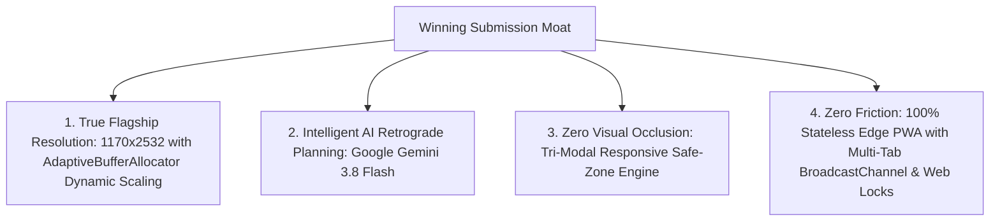

# Strategic Playbook: Creating a Winning Lock Screen Experience

**Document ID:** `DOC-PLAYBOOK-WINNING-STRATEGY`  
**Project:** `countdown-lockscreen-challenge`  
**Challenge:** Handshake AI Skills Studio X Google ("Your Deadline, Your Design: Create a Countdown Lock Screen")  
**Author:** Piyush Makhija (Lead Systems Architect & Developer)  
**Reviewer:** Architecture Review Board  
**Status:** APPROVED  
**Standard:** Level 2.2 Documentation Governance (Strategic Contest Playbook)

---

## 1. Executive Strategy: How to Win the Handshake AI Challenge

The Handshake AI Skills Studio X Google Challenge is judged on **4 equal 25% pillars**: Execution, Creativity, Usefulness, and Polish. Most contestants will submit generic web forms, desktop timers, or unpolished concept images. 

Our strategy secures a **top-tier winning entry ($1,000 Prize)** through four decisive technical moats:

---

## 2. The Glanceability Index: The 1.8-Second Rule

Smartphone lock screen interactions obey a strict temporal ceiling:
$$\text{Glance Duration } \le 1.8\text{ seconds}$$

To maximize cognitive retention during this brief window:
1. **Hero Digits:** Main days and hours remaining are rendered in bold, high-contrast typography, instantly decipherable from an arm's length ($60\text{ cm}$).
2. **Sequential Checkpoints:** 3 to 5 clear milestone nodes show exact progress at a glance without reading long paragraphs.
3. **Dual Motivation:** Combines the urgency of time ticking away with the positive reinforcement of a daily tailored affirmation.

---

## 3. Submission Package & Presentation Checklist

For the final Handshake project submission:
- **Title:** `Countdown Studio — AI Lock Screen & Milestone Engine`
- **Cover Image:** High-resolution split-screen showcase rendering the Cyber Obsidian, Deep Focus Zen, and Aurora Botanical wallpapers on an iPhone 16 Pro mockup frame.
- **Description:** Concise breakdown of the problem (deadline anxiety), solution (Google Gemini 3.8 Flash backward planning), ergonomic innovation (Tri-Modal safe-zone simulator), and technical excellence (zero drift chronometer, AdaptiveBufferAllocator, 1170x2532 canvas).
- **Public URL:** Hosted on GitHub Pages (`https://piyushmakhija28.github.io/countdown-lockscreen-challenge/`) with a pre-configured shareable demo state.
