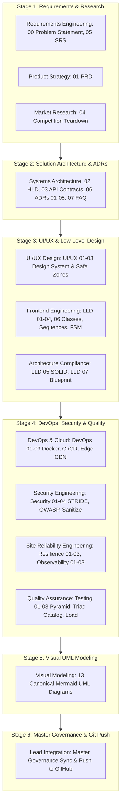

# Level 10: Management Specification — Service Orchestration DAG & Execution Pipeline

**Document ID:** `DOC-MGT-02-SERVICE-DAG`  
**Project:** `countdown-lockscreen-challenge`  
**Author:** Piyush Makhija (Lead Systems Architect & Developer)  
**Reviewer:** Architecture Review Board  
**Status:** APPROVED  
**Standard:** Level 2.3 Documentation Governance (Directed Acyclic Graph Pipeline)

---

## 1. Engineering Pipeline & Service Orchestration DAG

