# Level 10: Management Specification — Service Orchestration DAG & Execution Pipeline

**Document ID:** `DOC-MGT-02-SERVICE-DAG`  
**Project:** `countdown-lockscreen-challenge`  
**Challenge:** Handshake AI Skills Studio X Google ("Your Deadline, Your Design: Create a Countdown Lock Screen")  
**Author:** Piyush Makhija (Lead Systems Architect & Developer)  
**Reviewer:** Architecture Review Board  
**Status:** APPROVED  
**Standard:** Level 2.2 Documentation Governance (Directed Acyclic Graph Pipeline)  
**Version:** 2.3.0

---

## 1. Engineering Pipeline & Service Orchestration DAG

```mermaid
graph TD
    subgraph Discovery [Stage 1: Requirements & Research]
        BA[Requirements Engineering: 00 Problem Statement, 05 SRS]
        PM[Product Strategy: 01 PRD, 08 Submission Package]
        Research[Market Research: 04 Competition Teardown, Rules Summary, Playbook]
    end

    subgraph Architecture [Stage 2: Solution Architecture & ADRs]
        SA[Systems Architecture: 02 HLD, 03 API Contracts, ADRs 001-010, 07 FAQ]
    end

    subgraph DesignAndLLD [Stage 3: UI/UX & Low-Level Design]
        UI[UI/UX Design: UI/UX 01-03 Design System, Safe Zones & a11y]
        ReactEng[Frontend Engineering: LLD 01-04, 06 Classes, Sequences, FSM, Concurrency]
        Auditor[Architecture Compliance: LLD 05 SOLID, 07 Blueprint, 08-11 Deep Audits]
    end

    subgraph Hardening [Stage 4: DevOps, Security & Quality]
        DevOps[DevOps & Cloud: DevOps 01-03 Docker, CI/CD, Edge CDN]
        Security[Security Engineering: Security 01-04 STRIDE, OWASP, Credential, Sanitize]
        SRE[Site Reliability Engineering: Resilience 01-03, Observability 01-03]
        QA[Quality Assurance: Testing 01-03 Pyramid, Triad Catalog, Load]
    end

    subgraph Modeling [Stage 5: Visual UML Modeling]
        UML[Visual Modeling: 13 Canonical Mermaid UML Diagrams]
    end

    subgraph Assembly [Stage 6: Master Governance & Git Push]
        Orchestrator[Lead Integration: Master Governance Sync & Push to GitHub]
    end

    Discovery --> Architecture
    Architecture --> DesignAndLLD
    DesignAndLLD --> Hardening
    Hardening --> Modeling
    Modeling --> Assembly
```



---

## 2. Agent Delegation & Specialist Alignment (Claude Global Library)

Each pipeline stage is mapped to specialized subagent expertise from `claude-global-library`:

```
+--------------------------+-------------------------------------+---------------------------------------------+
| Pipeline Stage           | Subagent Type (Global Library)      | Primary Execution Scope                     |
+--------------------------+-------------------------------------+---------------------------------------------+
| **Stage 1: Discovery**   | `business-analyst-agent`            | IEEE 29148 requirements & 4x25% rubric math.|
| **Stage 2: Architecture**| `solution-architect`                | C4 models, Dual-Buffer canvas, ADRs 001-010.|
| **Stage 3: Design & LLD**| `react-engineer` / `ui-ux-designer` | Classes, sequences, Tri-modal safe zones.   |
| **Stage 4: Hardening**   | `security-defense-architect`        | Strict CSP Level 3, STRIDE, input sanitize. |
| **Stage 4: SRE & DevOps**| `devops-engineer` / `site-rel-eng`  | Docker multi-stage, Fastly Anycast edge CDN.|
| **Stage 5: Quality**     | `qa-testing-agent`                  | Positive, Negative, Edge Triad test catalog.|
| **Stage 6: Governance**  | `architecture-conformance-auditor`  | Level 2.2 verification & RTM completion.    |
+--------------------------+-------------------------------------+---------------------------------------------+
```

---

## 3. Application Runtime Service Orchestration DAG (All 17 Classes)

The client-side runtime adheres to a strict Directed Acyclic Graph (DAG) with zero circular dependencies ($D \le 0.15$):

```mermaid
graph TD
    App[CountdownApp: Root Orchestrator]

    subgraph CoreDomain [Tier 1: Core Domain & State Architecture]
        Store[StateStore: Trampoline Dispatch & Tab Sync]
        Time[DualClockTimeEngine: Hybrid Chronometer]
        MM[MilestoneManager: Checkpoint Logic]
        Sanitizer[InputSanitizer: Unicode NFKC Shield]
        State[UrlStateService: Base64URL Codec]
        Guard[TokenBucketHistoryGuard: Rate Limiter]
        Scope[LifecycleScope: RAII Signal Binding]
        Storage[ResilientStorageService: 4-Tier Ladder]
        Ports[CleanArchitecturePorts: Abstract Interfaces]
    end

    subgraph AIService [Tier 2: AI Intelligence & Offline Fallback]
        Gemini[GeminiAiClient: 3.8 Flash SDK Client]
        Limiter[GeminiRateLimiter: 15 RPM Token Bucket]
        Heuristic[HeuristicGenerator: Quarter Partition Fallback]
    end

    subgraph PlatformServices [Tier 3: Platform & Sensory Services]
        Worker[WorkerTickerAdapter: Inline Blob 1Hz Ticker]
        Audio[AudioChimeService: Procedural Web Audio FSM]
        Haptic[HapticService: Vibration API Patterns]
        Font[FontService: Canvas FOIT Barrier Gate]
    end

    subgraph CanvasPipeline [Tier 4: Canvas 2D Graphics Pipeline]
        Themes[themes.js: Curated Design Tokens]
        Alloc[AdaptiveBufferAllocator: Dual-Constraint Solver]
        Layout[ResponsiveLayoutEngine: Tri-Modal Geometry]
        Text[CanvasTextWrapper: Intl.Segmenter Wrapper]
        Overlay[SafeZoneOverlay: Safe Zone Guides]
        Particles[ParticleEngine: Float32Array Drag Physics]
        Renderer[CanvasRenderer: Master 2D Rasterizer]
    end

    App --> Store
    App --> Scope
    App --> Storage
    App --> Time
    App --> Sanitizer
    App --> State
    App --> Guard
    App --> Audio
    App --> Haptic
    App --> Font
    App --> Renderer

    Store --> MM
    Time --> Worker
    Time --> Ports
    Guard --> Storage
    Guard --> Scope

    MM --> Gemini
    MM --> Heuristic
    Gemini --> Limiter
    Gemini --> Ports
    Heuristic --> Ports

    Renderer --> Alloc
    Renderer --> Layout
    Renderer --> Text
    Renderer --> Overlay
    Renderer --> Font
    Renderer --> Themes
    Renderer --> Ports

    Time -.-> Renderer
    Particles -.-> Renderer
```


