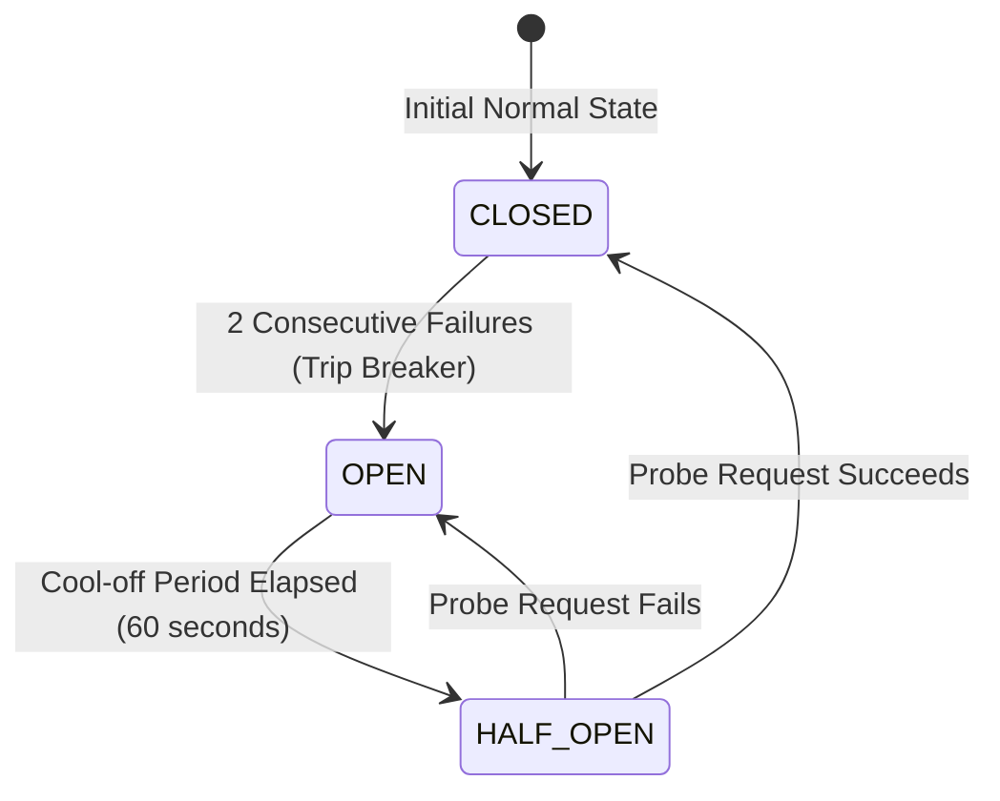

# Level 7: Resilience Specification — Timeout & Exponential Backoff Retry Policy

**Document ID:** `DOC-RES-02-RETRY-POLICY`  
**Project:** `countdown-lockscreen-challenge`  
**Challenge:** Handshake AI Skills Studio X Google ("Your Deadline, Your Design: Create a Countdown Lock Screen")  
**Author:** Piyush Makhija (Lead Systems Architect & Developer)  
**Reviewer:** Architecture Review Board  
**Status:** APPROVED  
**Standard:** Level 2.3 Documentation Governance (Exponential Backoff & Circuit Breaker)

---

## 1. Exponential Backoff with Decorrelated Jitter Formulation

When retrying transient network errors (HTTP 500, 502, 503, 504), retries obey the **Full Jitter Exponential Backoff algorithm**:

$$t_{\text{sleep}} = \text{random}(0, \min(t_{\max}, t_0 \cdot 2^{\text{attempt}}))$$

Where:
- Initial base delay $t_0 = 500\text{ms}$.
- Maximum backoff ceiling $t_{\max} = 3000\text{ms}$.
- Maximum retry count $N_{\text{max}} = 2$.
- Total allowed cumulative wait time $\le 4000\text{ms}$.

If retries are exhausted or if HTTP 429 (Rate Limit) is received, the retry loop aborts immediately to avoid user-perceived lag, and routes seamlessly to `HeuristicGenerator`.

---

## 2. Circuit Breaker State Machine

- **CLOSED:** All AI decomposition requests route to Google Gemini.
- **OPEN:** Gemini requests are short-circuited; requests route directly to `HeuristicGenerator` without network round-trips.
- **HALF_OPEN:** A single canary request tests Gemini availability.
