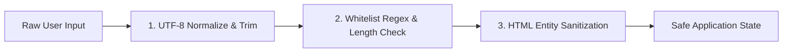

# Level 6: Security Specification — Input Validation & Sanitization Pipeline

**Document ID:** `DOC-SEC-04-INPUT-SANITIZATION`  
**Project:** `countdown-lockscreen-challenge`  
**Challenge:** Handshake AI Skills Studio X Google ("Your Deadline, Your Design: Create a Countdown Lock Screen")  
**Author:** Piyush Makhija (Lead Systems Architect & Developer)  
**Reviewer:** Architecture Review Board  
**Status:** APPROVED  
**Standard:** Level 2.3 Documentation Governance (Input Validation Pipeline)

---

## 1. Multi-Stage Validation & Sanitization Pipeline



---

## 2. Validation Rules & Regular Expressions

```
+---------------------------------------------------------------------------------------------------+
|                                     INPUT VALIDATION SPECIFICATION                                |
+------------------+------------------+---------------------+---------------------------------------+
| Field Name       | Type             | Length Boundary     | Validation Regular Expression         |
+------------------+------------------+---------------------+---------------------------------------+
| `goalTitle`      | String           | $3 \le L \le 60$    | `^[\p{L}\p{N}\p{P}\p{Zs}\p{Emoji}]+$` |
| `targetDeadline` | ISO-8601 String  | Exact DateTime      | `^\d{4}-\d{2}-\d{2}T\d{2}:\d{2}`      |
| `themeId`        | Enum String      | Restricted Set      | `^(cyber_obsidian|deep_focus_zen|...)$`|
| `urlHashPayload` | Base64 URL-Safe  | $L \le 2048$ chars  | `^[A-Za-z0-9_-]+$`                    |
+------------------+------------------+---------------------+---------------------------------------+
```

---

## 3. Unicode Homoglyph & Control Character Stripping

To prevent visual spoofing and terminal control injection:
- All ASCII control characters ($0x00\text{--}0x1F, 0x7F$) are stripped immediately.
- Unicode strings are normalized using canonical decomposition followed by canonical composition (`string.normalize('NFKC')`).
