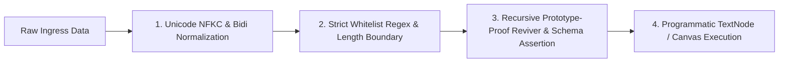

# Level 6: Security Specification — Input Validation & Sanitization Pipeline

**Document ID:** `DOC-SEC-04-INPUT-SANITIZATION`  
**Project:** `countdown-lockscreen-challenge`  
**Challenge:** Handshake AI Skills Studio X Google ("Your Deadline, Your Design: Create a Countdown Lock Screen")  
**Author:** Piyush Makhija (Lead Systems Architect & Developer)  
**Reviewer:** Architecture Review Board  
**Status:** APPROVED  
**Standard:** Level 2.2 Documentation Governance (Input Validation Pipeline)

---

## 1. Multi-Stage Validation & Sanitization Pipeline

To protect against Cross-Site Scripting (XSS), prototype pollution, Denial of Service (ReDoS/Decompression Bombs), and Trojan Source visual cloaking attacks, all user and URL ingress passes through a rigorous four-stage defensive pipeline:



---

## 2. Validation Rules & Regular Expressions

```
+---------------------------------------------------------------------------------------------------------------+
|                                      INPUT VALIDATION SPECIFICATION MATRIX                                    |
+------------------+------------------+---------------------+---------------------------------------------------+
| Field Name       | Data Type        | Length Boundary     | Defensive Validation Constraint                   |
+------------------+------------------+---------------------+---------------------------------------------------+
| `goalTitle`      | Unicode String   | $3 \le L \le 60$    | `^[\p{L}\p{N}\p{Zs}\.\,\-\_\!\?\:\(\)\[\]\p{Extended_Pictographic}]{3,60}$/u` |
| `targetDeadline` | ISO-8601 UTC     | Valid Calendar Date | $t_{\text{now}} + 60\text{s} \le t_{\text{target}} \le t_{\text{now}} + 5\text{ years}$ |
| `themeId`        | Strict Enum      | Restricted Set      | `^(cyber_obsidian\|deep_focus_zen\|aurora_botanical)$` |
| `urlHashPayload` | Base64 URL-Safe  | $L \le 2048$ chars  | `^[A-Za-z0-9_-]+$` (Capped at 32 KB decompressed) |
+------------------+------------------+---------------------+---------------------------------------------------+
```

### 2.1 The Whitelist Regex Formulation
The previous generic category `\p{P}` was removed because it permits dangerous injection characters (`<`, `>`, `"`, `'`, `&`, `/`, `\`, `;`, `#`, `=`). The hardened whitelist permits only:
- All Unicode letters (`\p{L}`) across all world languages (English, Hindi, Arabic, Japanese, etc.)
- Unicode numbers (`\p{N}`)
- Whitespace separators (`\p{Zs}`)
- Safe punctuation: `.` `,` `-` `_` `!` `?` `:` `(` `)` `[` `]`
- Extended pictographic emojis (`\p{Extended_Pictographic}`)

---

## 3. Trojan Source & Bidirectional Override Stripping

To prevent **Trojan Source attacks** (visual manipulation of text direction that cloaks code or reverses countdown digits), the sanitizer strips all Unicode Bidi control characters and ASCII/Unicode control characters:

```typescript
/**
 * Sanitizes and normalizes raw goal title text.
 * Strips ASCII control characters and dangerous Unicode Bidi formatting marks.
 *
 * @param raw Unsanitized user input string
 * @returns Normalized, validated goal title
 * @throws {ValidationError} If input violates length or character constraints
 */
export function sanitizeGoalTitle(raw: string): string {
  if (typeof raw !== 'string') {
    throw new Error('Goal title must be a valid string');
  }

  // 1. Unicode Canonical Decomposition and Composition (NFKC)
  let cleaned = raw.normalize('NFKC');

  // 2. Strip ASCII (0x00-0x1F, 0x7F) and Unicode control codes (0x80-0x9F)
  cleaned = cleaned.replace(/[\u0000-\u001F\u007F-\u009F]/g, '');

  // 3. Strip Trojan Source Bidi overrides: LRE, RLE, PDF, LRO, RLO, LRI, RLI, FSI, PDI
  cleaned = cleaned.replace(/[\u200E\u200F\u202A-\u202E\u2066-\u2069]/g, '').trim();

  // 4. Length constraints check
  if (cleaned.length < 3 || cleaned.length > 60) {
    throw new Error('Goal title must be between 3 and 60 characters in length');
  }

  // 5. Whitelist character validation
  const whitelist = /^[\p{L}\p{N}\p{Zs}\.\,\-\_\!\?\:\(\)\[\]\p{Extended_Pictographic}]{3,60}$/u;
  if (!whitelist.test(cleaned)) {
    throw new Error('Goal title contains forbidden characters (HTML tags and quotes are prohibited)');
  }

  return cleaned;
}
```

---

## 4. Prototype Pollution & Decompression Bomb Immunity

During hydration of the `#v1=` shareable URL hash payload, the application enforces two defenses:
1. **Decompression Bomb Shield:** Limits decompressed state bytes to a strict $32\text{ KB}$ ceiling, rejecting exponential memory expansion attacks.
2. **Recursive JSON Reviver:** The native JSON parser reviver traverses all object levels (root, milestone arrays, nested properties) and strips `__proto__`, `constructor`, and `prototype`. State is stored in a prototype-free `Object.create(null)` container.

```typescript
/**
 * Safely decodes, decompresses, and hydrates application state from a URL hash string.
 * Enforces a 32 KB decompression ceiling and prototype pollution immunity.
 *
 * @param base64Payload Base64 URL-encoded payload string
 * @returns Fully validated and prototype-clean AppState record
 */
export async function parseSafeUrlState(base64Payload: string): Promise<Record<string, unknown>> {
  if (base64Payload.length > 2048) {
    throw new Error('URL payload exceeds maximum permitted length of 2048 characters');
  }

  // 1. Convert Base64URL to binary Uint8Array
  const binaryString = atob(base64Payload.replace(/-/g, '+').replace(/_/g, '/'));
  const bytes = new Uint8Array(binaryString.length);
  for (let i = 0; i < binaryString.length; i++) {
    bytes[i] = binaryString.charCodeAt(i);
  }

  // 2. Safe Decompression with 32 KB Budget
  let decompressedText = '';
  try {
    const stream = new Blob([bytes]).stream().pipeThrough(new DecompressionStream('deflate-raw'));
    const reader = stream.getReader();
    let totalBytes = 0;
    const chunks: Uint8Array[] = [];

    while (true) {
      const { done, value } = await reader.read();
      if (done) break;
      totalBytes += value.byteLength;
      if (totalBytes > 32768) {
        reader.cancel();
        throw new Error('Payload exceeded 32KB decompression ceiling');
      }
      chunks.push(value);
    }

    const totalBuffer = new Uint8Array(totalBytes);
    let offset = 0;
    for (const chunk of chunks) {
      totalBuffer.set(chunk, offset);
      offset += chunk.byteLength;
    }
    decompressedText = new TextDecoder('utf-8', { fatal: true }).decode(totalBuffer);
  } catch {
    // Fallback: decode uncompressed raw UTF-8 string
    decompressedText = new TextDecoder('utf-8', { fatal: true }).decode(bytes);
  }

  // 3. Recursive Prototype-Proof JSON Reviver
  const parsed = JSON.parse(decompressedText, (key, value) => {
    if (key === '__proto__' || key === 'constructor' || key === 'prototype') {
      return undefined;
    }
    return value;
  });

  // 4. Schema Assertions and Normalization
  const safeState = Object.create(null);
  safeState.v = typeof parsed.v === 'number' ? parsed.v : 1;
  safeState.t = sanitizeGoalTitle(parsed.t || 'My Goal');
  safeState.d = new Date(parsed.d).toISOString();
  safeState.th = ['cyber_obsidian', 'deep_focus_zen', 'aurora_botanical'].includes(parsed.th)
    ? parsed.th
    : 'cyber_obsidian';
  safeState.af = typeof parsed.af === 'string' ? parsed.af.slice(0, 120) : '';

  safeState.m = Array.isArray(parsed.m)
    ? parsed.m.slice(0, 5).map((item: any, idx: number) => ({
        step: idx + 1,
        title: typeof item.title === 'string' ? item.title.slice(0, 50) : `Milestone ${idx + 1}`,
        offset_days: Math.max(0, Math.min(1825, Number(item.offset_days) || 0)),
        completed: Boolean(item.completed)
      }))
    : [];

  return safeState;
}
```
