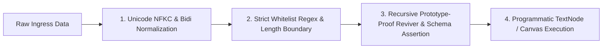
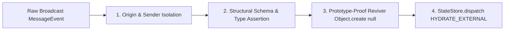

# Level 6: Security Specification — Input Validation & Sanitization Pipeline

**Document ID:** `DOC-SEC-04-INPUT-SANITIZATION`  
**Project:** `countdown-lockscreen-challenge`  
**Challenge:** Handshake AI Skills Studio X Google ("Your Deadline, Your Design: Create a Countdown Lock Screen")  
**Author:** Piyush Makhija (Lead Systems Architect & Developer)  
**Reviewer:** Architecture Review Board  
**Status:** APPROVED  
**Standard:** Level 2.2 Documentation Governance (Input Validation Pipeline)  
**Version:** 2.3.0

---

## 1. Multi-Stage Validation & Sanitization Pipeline

To protect against Cross-Site Scripting (XSS), prototype pollution, Denial of Service (ReDoS/Decompression Bombs), and Trojan Source visual cloaking attacks, all user and URL ingress passes through a rigorous four-stage defensive pipeline:



---

## 2. Validation Rules & Regular Expressions

```
+-----------------------------------------------------------------------------------------------------------------------+
|                                           INPUT VALIDATION SPECIFICATION MATRIX                                       |
+------------------+------------------+---------------------+-----------------------------------------------------------+
| Field Name       | Data Type        | Length Boundary     | Defensive Validation Constraint                           |
+------------------+------------------+---------------------+-----------------------------------------------------------+
| `goalTitle`      | Unicode String   | $3 \le L \le 60$    | `^[\p{L}\p{M}\p{N}\p{Zs}\.\,\-\_\!\?\:\(\)\[\]\p{Extended_Pictographic}]{3,60}$/u` |
| `targetDeadline` | ISO-8601 UTC     | Valid Calendar Date | $t_{\text{now}} + 60\text{s} \le t_{\text{target}} \le t_{\text{now}} + 5\text{ years}$ |
| `themeId`        | Strict Enum      | Restricted Set      | `^(cyber_obsidian\|deep_focus_zen\|aurora_botanical)$`    |
| `urlHashPayload` | Base64 URL-Safe  | $L \le 2048$ chars  | `^[A-Za-z0-9_-]+$` (Capped at 32 KB decompressed)         |
+------------------+------------------+---------------------+-----------------------------------------------------------+
```

### 2.1 The Whitelist Regex Formulation
The previous generic category `\p{P}` was removed because it permits dangerous injection characters (`<`, `>`, `"`, `'`, `&`, `/`, `\`, `;`, `#`, `=`). The hardened whitelist permits only:
- All Unicode letters (`\p{L}`) across all world languages (English, Hindi, French, Japanese, etc.)
- Unicode combining marks (`\p{M}`) for diacritics and non-Latin vowel signs
- Unicode numbers (`\p{N}`)
- Whitespace separators (`\p{Zs}`)
- Safe punctuation: `.` `,` `-` `_` `!` `?` `:` `(` `)` `[` `]`
- Extended pictographic emojis (`\p{Extended_Pictographic}`)

### 2.2 Standardized Domain Validation Error Codes
To ensure deterministic error handling across UI form controls and telemetry collectors:

```
+---------------------------------------------------------------------------------------------------------------+
|                                      STANDARDIZED DOMAIN VALIDATION ERROR CODES                               |
+--------------------------+---------------------+--------------------------------------------------------------+
| Error Code Constant      | HTTP / Logic Tier   | Trigger Condition & Remediation Strategy                     |
+--------------------------+---------------------+--------------------------------------------------------------+
| `ERR_TITLE_LENGTH`       | Form Validation     | Goal title length is < 3 or > 60 Unicode code points.        |
| `ERR_TITLE_INVALID_CHARS`| Input Sanitizer     | Contains unapproved characters (<, >, script tags, controls).|
| `ERR_PAYLOAD_TOO_LARGE`  | URL Deserializer    | Base64 URL state string exceeds 2048 character limit.        |
| `ERR_DECOMPRESSION_BOMB` | Security Bulkhead   | Decompressed payload stream expands beyond 32 KB threshold.  |
| `ERR_AI_SAFETY_BLOCK`    | Gemini AI Client    | Gemini API blocks response due to safety / harm filters.     |
+--------------------------+---------------------+--------------------------------------------------------------+
```

---

## 3. Trojan Source & Bidirectional Override Stripping

To prevent **Trojan Source attacks** (visual manipulation of text direction that cloaks code or reverses countdown digits), the sanitizer strips all Unicode Bidi control characters and ASCII/Unicode control characters:

```javascript
/**
 * Sanitizes and normalizes raw goal title text.
 * Strips ASCII control characters and dangerous Unicode Bidi formatting marks.
 *
 * @param {string} raw Unsanitized user input string
 * @returns {string} Normalized, validated goal title
 * @throws {ValidationError} If input violates length or character constraints
 */
export function sanitizeGoalTitle(raw) {
  if (typeof raw !== 'string') {
    const err = new Error('Goal title must be a valid string');
    err.code = 'ERR_TITLE_EMPTY';
    throw err;
  }

  // 1. Unicode Canonical Decomposition and Composition (NFKC)
  let cleaned = raw.normalize('NFKC');

  // 2. Strip ASCII (0x00-0x1F, 0x7F) and Unicode control codes (0x80-0x9F)
  cleaned = cleaned.replace(/[\u0000-\u001F\u007F-\u009F]/g, '');

  // 3. Strip Trojan Source Bidi overrides: LRE, RLE, PDF, LRO, RLO, LRI, RLI, FSI, PDI
  cleaned = cleaned.replace(/[\u200E\u200F\u202A-\u202E\u2066-\u2069]/g, '').trim();

  // 4. Length constraints check
  if (cleaned.length < 3 || cleaned.length > 60) {
    const err = new Error('Goal title must be between 3 and 60 characters in length');
    err.code = 'ERR_TITLE_LENGTH';
    throw err;
  }

  // 5. Whitelist character validation including combining marks (\p{M})
  const whitelist = /^[\p{L}\p{M}\p{N}\p{Zs}\.\,\-\_\!\?\:\(\)\[\]\p{Extended_Pictographic}]{3,60}$/u;
  if (!whitelist.test(cleaned)) {
    const err = new Error('Goal title contains forbidden characters (HTML tags and quotes are prohibited)');
    err.code = 'ERR_TITLE_INVALID_CHARS';
    throw err;
  }

  return cleaned;
}
```

---

## 4. Prototype Pollution & Decompression Bomb Immunity

During hydration of the `#v1=` shareable URL hash payload, the application enforces three defenses:
1. **Base64URL Bit-Quantum Integrity Check:** In standard Base64, each character encodes 6 bits. A payload length of $L \equiv 1 \pmod 4$ requires 6 bits, which cannot form a complete 8-bit byte. Any payload where $L \pmod 4 === 1$ is immediately rejected with `ERR_HASH_CORRUPT` before invoking browser decoding APIs.
2. **Decompression Bomb Shield:** Limits decompressed state bytes to a strict $32\text{ KB}$ ceiling, rejecting exponential memory expansion attacks with immediate error propagation.
3. **Recursive Zero-Prototype JSON Reviver:** The native JSON parser reviver traverses all object levels (root, milestone arrays, nested properties) and strips `__proto__`, `constructor`, and `prototype`. All revived objects are instantiated via `Object.create(null)` dictionaries and frozen.

```javascript
/**
 * Safely decodes, decompresses, and hydrates application state from a URL hash string.
 * Enforces a 32 KB decompression ceiling, Base64 padding normalization, and prototype pollution immunity.
 *
 * @param {string} base64Payload Base64 URL-encoded payload string
 * @returns {Promise<Record<string, any>>} Fully validated and prototype-clean AppState record
 * @throws {Error} If decompression bomb or invalid payload is detected
 */
export async function parseSafeUrlState(base64Payload) {
  if (typeof base64Payload !== 'string' || base64Payload.length > 2048) {
    const err = new Error('URL payload exceeds maximum permitted length of 2048 characters');
    err.code = 'ERR_PAYLOAD_TOO_LARGE';
    throw err;
  }

  // 1. Bit-quantum validation: length % 4 === 1 is mathematically impossible for valid Base64
  if (base64Payload.length % 4 === 1) {
    const err = new Error('Malformed Base64URL string length: bit quantum invalid');
    err.code = 'ERR_HASH_CORRUPT';
    throw err;
  }

  // 2. Base64URL padding normalization
  const padLen = (4 - (base64Payload.length % 4)) % 4;
  const normalizedBase64 = (base64Payload + '='.repeat(padLen))
    .replace(/-/g, '+')
    .replace(/_/g, '/');

  let binaryString;
  try {
    binaryString = atob(normalizedBase64);
  } catch {
    const err = new Error('Invalid Base64 payload');
    err.code = 'ERR_HASH_CORRUPT';
    throw err;
  }

  const bytes = new Uint8Array(binaryString.length);
  for (let i = 0; i < binaryString.length; i++) {
    bytes[i] = binaryString.charCodeAt(i);
  }
```

  // 2. Safe Decompression with strict 32 KB Budget
  let decompressedText = '';
  let decompressionSucceeded = false;

  if (typeof DecompressionStream !== 'undefined') {
    try {
      const stream = new Blob([bytes]).stream().pipeThrough(new DecompressionStream('deflate-raw'));
      const reader = stream.getReader();
      let totalBytes = 0;
      const chunks = [];

      while (true) {
        const { done, value } = await reader.read();
        if (done) break;
        totalBytes += value.byteLength;
        if (totalBytes > 32768) {
          reader.cancel();
          const err = new Error('Payload exceeded 32KB decompression ceiling');
          err.code = 'ERR_DECOMPRESSION_BOMB';
          throw err;
        }
        chunks.push(value);
      }

      const totalBuffer = new Uint8Array(totalBytes);
      let offset = 0;
      for (const chunk of chunks) {
        totalBuffer.set(chunk, offset);
        offset += chunk.byteLength;
      }
      decompressedText = new TextDecoder('utf-8', { fatal: true }).decode(totalBuffer);
      decompressionSucceeded = true;
    } catch (err) {
      if (err.code === 'ERR_DECOMPRESSION_BOMB') {
        throw err;
      }
      // If deflation stream fails on raw uncompressed data, proceed to fallback
    }
  }

  if (!decompressionSucceeded) {
    if (bytes.length > 32768) {
      const err = new Error('Uncompressed payload exceeds 32KB ceiling');
      err.code = 'ERR_DECOMPRESSION_BOMB';
      throw err;
    }
    try {
      decompressedText = new TextDecoder('utf-8', { fatal: true }).decode(bytes);
    } catch {
      const err = new Error('UTF-8 decoding failed for uncompressed payload');
      err.code = 'ERR_HASH_CORRUPT';
      throw err;
    }
  }

  // 3. Recursive Prototype-Proof JSON Reviver & Root Type Validation
  let parsed;
  try {
    parsed = JSON.parse(decompressedText, (key, value) => {
      if (key === '__proto__' || key === 'constructor' || key === 'prototype') {
        return undefined;
      }
      return value;
    });
  } catch {
    const err = new Error('JSON parsing failed on decompressed state');
    err.code = 'ERR_HASH_CORRUPT';
    throw err;
  }

  if (parsed === null || typeof parsed !== 'object' || Array.isArray(parsed)) {
    const err = new Error('Root state payload must be a non-null object');
    err.code = 'ERR_HASH_CORRUPT';
    throw err;
  }

  // 4. Schema Assertions, Whitelist Normalization & Polymorphic Milestones
  const safeState = Object.create(null);
  safeState.v = typeof parsed.v === 'number' ? parsed.v : 1;
  safeState.t = sanitizeGoalTitle(parsed.t || 'My Goal');
  safeState.d = new Date(parsed.d).toISOString();
  safeState.th = ['cyber_obsidian', 'deep_focus_zen', 'aurora_botanical'].includes(parsed.th)
    ? parsed.th
    : 'cyber_obsidian';
  safeState.af = typeof parsed.af === 'string' ? parsed.af.slice(0, 120) : '';

  // Polymorphic milestone normalization (supporting tuples [step, title, offset, completed] and objects)
  safeState.m = Array.isArray(parsed.m)
    ? parsed.m.slice(0, 5).map((item, idx) => {
        if (Array.isArray(item)) {
          return {
            step: typeof item[0] === 'number' ? item[0] : idx + 1,
            title: typeof item[1] === 'string' && item[1].trim().length > 0
              ? item[1].slice(0, 50).trim()
              : `Milestone ${idx + 1}`,
            offset_days: Math.max(0, Math.min(1825, Number(item[2]) || 0)),
            completed: Boolean(item[3])
          };
        } else if (item && typeof item === 'object') {
          return {
            step: typeof item.step === 'number' ? item.step : idx + 1,
            title: typeof item.title === 'string' && item.title.trim().length > 0
              ? item.title.slice(0, 50).trim()
              : `Milestone ${idx + 1}`,
            offset_days: Math.max(0, Math.min(1825, Number(item.offset_days) || 0)),
            completed: Boolean(item.completed)
          };
        }
        return {
          step: idx + 1,
          title: `Milestone ${idx + 1}`,
          offset_days: 0,
          completed: false
        };
      })
    : [];

  return safeState;
}

/**
 * Safe deserialization error boundary returning deterministic fallback demo state upon payload corruption.
 *
 * @param {string} base64Payload
 * @returns {Promise<Record<string, unknown>>}
 */
export async function safeDeserializeState(base64Payload) {
  try {
    return await deserializeState(base64Payload);
  } catch (err) {
    console.warn('safeDeserializeState: Corrupt or invalid state payload, applying fallback state', err);
    return {
      v: 1,
      t: 'Launch AI Product',
      d: new Date(Date.now() + 30 * 24 * 60 * 60 * 1000).toISOString(),
      th: 'cyber_obsidian',
      af: 'Consistency compounds into mastery.',
      m: [
        { step: 1, title: 'Phase 1: Foundation & Requirements Mastery', offset_days: 21, completed: false },
        { step: 2, title: 'Phase 2: Deep Core Execution & Build Sprint', offset_days: 14, completed: false },
        { step: 3, title: 'Phase 3: Validation, Mock Review & Refinement', offset_days: 7, completed: false },
        { step: 4, title: 'Phase 4: Final Polish & Deadline Achievement', offset_days: 0, completed: false }
      ]
    };
  }
}
```

---

## 5. Canvas CSS Font Injection Defense (`SafeFontEngine`)

When dynamically formatting `ctx.font = "${fontWeight} ${fontSize}px ${fontFamily}"`, unsanitized strings can lead to font-injection attacks or canvas rendering stalls. `SafeFontEngine` strictly enforces an authorized font family whitelist:

```javascript
/**
 * Defensive Canvas 2D font property constructor blocking font injection sinks.
 */
export class SafeFontEngine {
  static #AUTHORIZED_FAMILIES = new Set([
    'Inter',
    'JetBrains Mono',
    'Cinzel',
    'Playfair Display',
    'sans-serif',
    'monospace',
    'serif'
  ]);

  /**
   * Constructs a validated font property string.
   *
   * @param {number | string} weight Numeric weight (e.g., 400, 700)
   * @param {number} sizePx Clamped font size in pixels (8 to 512)
   * @param {string} family Requested font family
   * @returns {string} Safe ctx.font specification
   * @throws {ValidationError} If font family is unauthorized or size is out of bounds
   */
  static buildFontSpec(weight, sizePx, family) {
    const cleanFamily = family.replace(/['";\\]/g, '').trim();
    if (!this.#AUTHORIZED_FAMILIES.has(cleanFamily)) {
      throw new ValidationError(`Unauthorized font family: ${cleanFamily}`, 'ERR_FONT_UNAUTHORIZED');
    }
    const clampedSize = Math.max(8, Math.min(512, Math.round(Number(sizePx) || 16)));
    const cleanWeight = [300, 400, 500, 600, 700, 800, 'normal', 'bold'].includes(weight) ? weight : 400;
    return `${cleanWeight} ${clampedSize}px "${cleanFamily}"`;
  }
}
```

---

## 6. Client-Side Persistent Rate Limiting (`PersistentGeminiRateLimiter`)

To protect the Google Gemini API Free Tier quota ($15\text{ RPM}$, $1500\text{ RPD}$) across multiple browser tabs and page refreshes, `PersistentGeminiRateLimiter` persists token balances and timestamps into `localStorage`:

```javascript
/**
 * Cross-tab persistent token-bucket rate limiter enforcing 15 RPM with 2.0s minimum spacing.
 */
export class PersistentGeminiRateLimiter {
  static #STORAGE_KEY = 'gemini_rate_guard_v1';
  static #CAPACITY = 15;
  static #PACING_MS = 2000;
  static #REFILL_INTERVAL_MS = 60000;

  /**
   * Acquires a dispatch permit or throws AiServiceError if rate limit is exceeded.
   *
   * @throws {AiServiceError} If 15 RPM quota is exhausted or request violates 2.0s pacing interval
   */
  static acquireToken() {
    const now = Date.now();
    const todayUtc = new Date().toISOString().slice(0, 10);
    let record;

    try {
      const raw = localStorage.getItem(this.#STORAGE_KEY);
      record = raw ? JSON.parse(raw) : null;
    } catch {
      record = null;
    }

    if (!record || record.dayUtc !== todayUtc) {
      record = { dayUtc: todayUtc, tokens: this.#CAPACITY, lastRefill: now, lastCall: 0, dailyCalls: 0 };
    }

    // Refill bucket based on elapsed 60s windows
    const elapsed = now - record.lastRefill;
    if (elapsed >= this.#REFILL_INTERVAL_MS) {
      record.tokens = this.#CAPACITY;
      record.lastRefill = now;
    }

    // Enforce 2.0s pacing interval
    const timeSinceLastCall = now - record.lastCall;
    if (timeSinceLastCall < this.#PACING_MS) {
      const waitSec = ((this.#PACING_MS - timeSinceLastCall) / 1000).toFixed(1);
      const err = new Error(`Pacing limit: Please wait ${waitSec}s before generating again.`);
      err.code = 'ERR_AI_PACING_THROTTLED';
      err.isRateLimit = true;
      throw err;
    }

    if (record.tokens <= 0) {
      const err = new Error('Gemini API free tier rate limit reached (15 RPM). Please wait 60s.');
      err.code = 'ERR_AI_HTTP_429';
      err.isRateLimit = true;
      throw err;
    }

    record.tokens -= 1;
    record.lastCall = now;
    record.dailyCalls += 1;

    try {
      localStorage.setItem(this.#STORAGE_KEY, JSON.stringify(record));
    } catch {
      // In-memory fallback if localStorage is disabled or full
    }
  }
}
```

---

## 4. Inter-Tab Broadcast Message Sanitization & Deserialization Pipeline

Incoming IPC events received via `BroadcastChannel('countdown_lockscreen_sync')` pass through an automated 4-tier defensive pipeline prior to ingestion into `StateStore`:



### 4.1 Defensive Ingress Constraints
1. **Sender Self-Filter:** Discards events where `event.data.senderId === this.#instanceId` to eliminate cyclic broadcast storms (`INV-017`).
2. **Structural Schema Assertion:** Validates that incoming payloads strictly possess mandatory properties:
   - `type`: Must match string constant `'SYNC_STATE_V1'`
   - `senderId`: Must be a non-empty string ($8 \le L \le 64$)
   - `timestamp`: Integer timestamp within $[t_{\text{now}} - 60000, t_{\text{now}} + 5000]$
   - `state`: Validated state object containing `goalTitle`, `targetEpochMs`, `themeId`, `milestones`
3. **Prototype Poisoning Defense:** Deserialized state maps through `Object.create(null)` stripping prototype inheritance.
4. **Exception Handling:** Corrupted or invalid payloads throw `BroadcastChannelSyncError` with error code `SYNC_CHANNEL_CORRUPTED` and are isolated without crashing the application event loop (`TC-NEG-15`).

