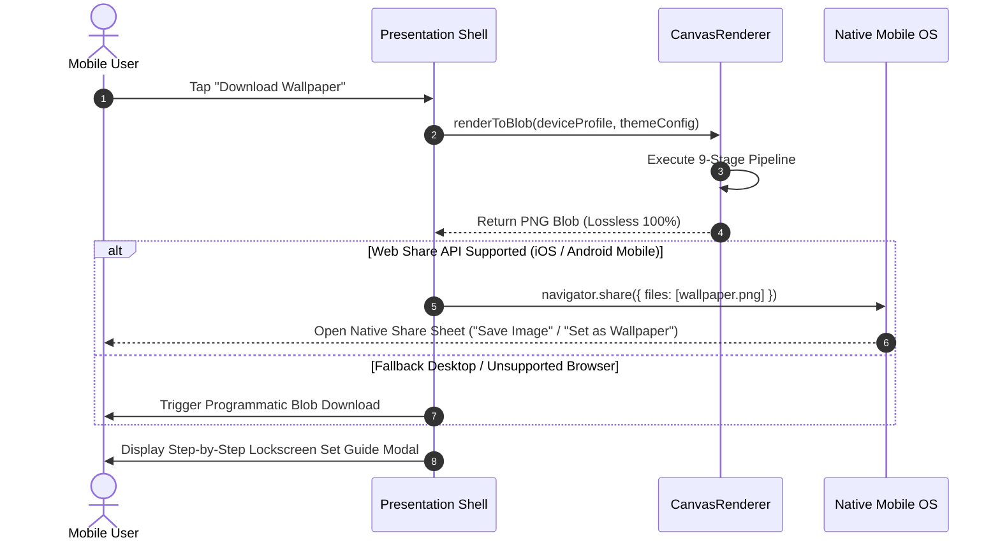

# Level 3: Canvas Wallpaper Composition Engine & Multi-Device Rasterization
### (9-Stage Offscreen Pipeline, Dynamic Ambient Scrim, Flagship Resolution Matrix & WebKit Memory Defense)

**Document ID:** `DOC-UI-09-CANVAS-WALLPAPER-COMPOSITION-ENGINE`  
**Project:** `countdown-lockscreen-challenge`  
**Challenge:** Handshake AI Skills Studio X Google ("Your Deadline, Your Design: Create a Countdown Lock Screen")  
**Author:** Piyush Makhija (Lead Systems Architect & Developer)  
**Reviewer:** Architecture Review Board  
**Status:** APPROVED  
**Standard:** Level 2.2 Documentation Governance (High-DPI Rasterization & Hardware Texture Engineering)  
**Version:** 2.3.5  

---

## 1. Executive Summary & Canvas Architecture Overview

The primary tangible deliverable of the Countdown Lock Screen application is an ultra-high-resolution, downloadable mobile lock screen wallpaper. While the interactive web application simulates lock screen behaviors in a responsive DOM shell, generating a production-ready mobile wallpaper demands an **Offscreen HTML5 Canvas 2D Composition Pipeline** capable of producing razor-sharp typography, accurate safe-zone clipping, optical glassmorphic reflections, and contrast-adapted text across heterogeneous flagship device viewports.

This specification provides the low-level rendering equations, spatial coordinate maps, and memory safeguards governing the wallpaper generation engine (`src/js/canvas/CanvasRenderer.js`).

```
+---------------------------------------------------------------------------------------------------------+
|                                  CANVAS WALLPAPER ENGINE HIGHLIGHTS                                     |
+---+----------------------------+-------------------------------------+----------------------------------+
| # | Architectural Dimension    | Specification Standard              | First-Principles Rationale       |
+---+----------------------------+-------------------------------------+----------------------------------+
| 1 | **Rasterization Pipeline** | 9-Stage Offscreen Canvas 2D Engine  | Decouples export from DOM render |
| 2 | **Hardware Matrix**        | 5 Flagship Target Profiles          | Covers iPhone, Pixel, Galaxy     |
| 3 | **Texture Memory Safety**  | AdaptiveBufferAllocator (Dual Limit)| Prevents WebKit 16.7MP crashes   |
| 4 | **Ambient Contrast Scrim** | Dynamic Luminance Histogram Engine  | Guarantees APCA Lc >= 75 outdoors|
| 5 | **Subpixel Precision**     | Math.floor(coord) + 0.5px offset    | Eliminates blurry 1px hairlines  |
| 6 | **Export Delivery Bridge** | Web Share API + Blob Stream Fallback| Direct OS wallpaper sheet handoff|
+---+----------------------------+-------------------------------------+----------------------------------+
```

---

## 2. Multi-Resolution Flagship Hardware Benchmark Matrix

The canvas layout engine dynamically calculates its base rendering dimensions $(W_{\text{canvas}}, H_{\text{canvas}})$ and Device Pixel Ratio supersampling factor ($S_{\text{DPR}}$) based on the user's selected device profile:

```
+---------------------------------------------------------------------------------------------------------------+
|                                    FLAGSHIP HARDWARE EXPORT MATRIX                                            |
+--------------------------+---------------------+-------------------+------------+---------------+-------------+
| Device Model             | Screen Diagonal     | Physical Pixels   | Native PPI | Aspect Ratio  | Top Safe Y  |
+--------------------------+---------------------+-------------------+------------+---------------+-------------+
| **iPhone 16 / 15 Pro**   | 6.1 in              | 1170 x 2532 px    | 460 ppi    | 19.5 : 9      | 709 px (28%)|
| **iPhone 16 Pro Max**    | 6.9 in              | 1320 x 2868 px    | 460 ppi    | 19.5 : 9      | 798 px (27.8|
| **Samsung Galaxy S24 U** | 6.8 in              | 1440 x 3120 px    | 505 ppi    | 19.5 : 9      | 874 px (28%)|
| **Google Pixel 9 Pro**   | 6.3 in              | 1280 x 2856 px    | 495 ppi    | 20.0 : 9      | 800 px (28%)|
| **Pixel 9 Pro Fold (Un)**| 8.0 in (Unfolded)   | 2076 x 2152 px    | 373 ppi    | 1.04 : 1      | 538 px (25%)|
+--------------------------+---------------------+-------------------+------------+---------------+-------------+
```

### 2.1 Closed-Form Memory Bound (WebKit Safari Protection)
Mobile Safari on iOS enforces a strict hardware texture memory ceiling: any canvas exceeding **$16,777,216\text{ pixels}$ ($16.7\text{ MP}$)** in total surface area or **$4096\text{px}$** along any single dimension causes WebKit to immediately terminate the GPU process, resulting in a blank white canvas crash.

The `AdaptiveBufferAllocator` computes the maximum safe scaling factor $S$ using a closed-form dual-constraint min-solver:

$$S = \min\left( 2.0, \; \sqrt{\frac{16,777,216}{W \cdot H}}, \; \frac{4096}{\max(W, H)} \right)$$

```javascript
/**
 * Computes hardware-constrained safe buffer dimensions for mobile WebKit.
 *
 * @param {number} width Target logical canvas width.
 * @param {number} height Target logical canvas height.
 * @param {number} requestedDpr Desired supersampling device pixel ratio.
 * @returns {{width: number, height: number, scale: number}} Bounded allocation dimensions.
 */
export function calculateSafeBufferSize(width, height, requestedDpr = 2.0) {
  const MAX_AREA = 16777216;
  const MAX_DIMENSION = 4096;

  const areaConstraint = Math.sqrt(MAX_AREA / (width * height));
  const dimensionConstraint = MAX_DIMENSION / Math.max(width, height);
  const safeScale = Math.min(requestedDpr, areaConstraint, dimensionConstraint);

  return {
    width: Math.floor(width * safeScale),
    height: Math.floor(height * safeScale),
    scale: safeScale
  };
}
```

---

## 3. The 9-Stage Canvas 2D Composition Pipeline

The wallpaper generation pipeline executes sequentially across **9 deterministic rendering stages**:

```
+---------------------------------------------------------------------------------------------------+
|                                  THE 9-STAGE CANVAS COMPOSITION PIPELINE                          |
+---------------------------------------------------------------------------------------------------+
|  [Stage 01] Buffer Dimension & High-DPI Context Scaling Initialization                            |
|  [Stage 02] Background Base Rasterization (OLED Dark Substrate + Bayer Dither)                    |
|  [Stage 03] Safe-Zone Exclusion Bounds Calculation & Coordinate Normalization                     |
|  [Stage 04] Ambient Lighting & Radial Hue Glow Bloom Synthesis                                    |
|  [Stage 05] Specular Circular Chronometer Arc & Elapsed Ratio Geometry                            |
|  [Stage 06] Tabular Chronometer Numerals & Unit Label Typography Layout                           |
|  [Stage 07] Milestone Chronometry Ladder (Connecting Rail, Checkpoints & Status Pins)             |
|  [Stage 08] Motivational Copy Block Word-Wrapping & Optical Alignment                              |
|  [Stage 09] Specular Glass Card Borders & Lossless PNG Blob Encoding                              |
+---------------------------------------------------------------------------------------------------+
```

### Stage 1: Buffer Initialization & Subpixel Coordinate Snapping
- Offscreen canvas initialized with dimensions $(W_{\text{buf}}, H_{\text{buf}})$.
- High-DPI context scale applied: `ctx.scale(scale, scale)`.
- Image smoothing set to high quality: `ctx.imageSmoothingEnabled = true; ctx.imageSmoothingQuality = 'high'`.
- Subpixel alignment offset formula: All 1px hairline strokes snap to half-pixel coordinates to prevent antialiasing blur:
  $$x_{\text{stroke}} = \lfloor x \rfloor + 0.5, \quad y_{\text{stroke}} = \lfloor y \rfloor + 0.5$$

### Stage 2: Background Base & Dithering
- Fills base canvas with OLED absolute black (`#08090d`).
- Executes 4x4 Bayer ordered dither matrix to break quantization banding across subtle gradient transitions.

### Stage 3: Safe-Zone Exclusion Bounds
- Calculates upper 28% exclusion boundary: $Y_{\text{clock\_bottom}} = 0.28 \times H_{\text{canvas}}$.
- Calculates lower 18% exclusion boundary: $Y_{\text{gesture\_top}} = 0.82 \times H_{\text{canvas}}$.
- Computes usable vertical lock screen canvas height:
  $$H_{\text{usable}} = Y_{\text{gesture\_top}} - Y_{\text{clock\_bottom}} = 0.54 \times H_{\text{canvas}}$$

### Stage 4: Ambient Lighting & Radial Glow
- Generates a subtle radial gradient centered behind the countdown timer at $(X_c, Y_c)$:
  $$\text{Gradient} = \text{radialGradient}(X_c, Y_c, r_{\text{inner}} = 0, X_c, Y_c, r_{\text{outer}} = 380\text{px})$$
- Gradient ramps from theme primary accent (`oklch(0.85 0.14 210 / 0.15)`) to transparent.

### Stage 5: Specular Circular Chronometer Arc
- Draws the circular progress ring centered at $(X_c, Y_{\text{ring\_center}})$:
  $$Y_{\text{ring\_center}} = Y_{\text{clock\_bottom}} + 0.22 \times H_{\text{usable}}$$
  $$R_{\text{ring}} = \min(0.30 \times W_{\text{canvas}}, 220\text{px})$$
- Base track drawn with stroke width $d_{\text{stroke}} = 12\text{px}$ in `rgba(255, 255, 255, 0.08)`.
- Active elapsed arc drawn from $\theta_0 = -90^\circ$ to $\theta_{\text{end}} = -90^\circ + 360^\circ \times \text{progressRatio}$.
- Specular arc head receives a glowing halo circle with radius $r = 10\text{px}$.

### Stage 6: Tabular Countdown Numerals & Unit Labels
- Draws days, hours, minutes, and seconds inside or directly below the circular ring.
- Numerals rendered in `JetBrains Mono` with `font-variant-numeric: tabular-nums`.
- Unit labels (`DAYS`, `HOURS`, `MINS`, `SECS`) rendered in `Inter` uppercase with tracking letter spacing ($+0.12\text{em}$).

### Stage 7: Milestone Chronometry Ladder
- Vertical rail drawn from $Y_{\text{start}} = Y_{\text{ring\_center}} + R_{\text{ring}} + 48\text{px}$ downward.
- For each milestone $i \in \{1, \dots, N\}$ ($N \le 5$):
  - Checkpoint circle rendered at $(X_{\text{rail}}, Y_i)$.
  - If completed: filled with accent color and rendered with white checkmark path.
  - If pending: hollow ring with 1.5px stroke.
  - Milestone label rendered in `Inter` with maximum word-wrap width $W_{\text{label}} = W_{\text{canvas}} - 160\text{px}$.

### Stage 8: Tailored Motivational Copy Block
- Renders contextual motivational message generated by Gemini 3.8 Flash or offline heuristic fallback.
- Auto-wrapped using greedy word-boundary algorithm into maximum 2 lines of text.
- Horizontally centered with optical negative vertical margin adjustment (visual center offset $y = -4\text{px}$).

### Stage 9: Lossless PNG Blob Encoding & Delivery
- Canvas converted to binary Blob via `canvas.toBlob((blob) => { ... }, 'image/png', 1.0)`.
- Invokes native Web Share API (`navigator.share({ files: [file] })`) on mobile browsers.
- Falls back to programmatic `<a download="countdown-wallpaper.png">` click trigger on desktop.

---

## 4. Dynamic Scrim & Ambient Luminance Normalization Engine

### 4.1 Heterogeneous Wallpaper Contrast Hazard
When users select or upload custom photographic wallpapers (e.g., bright daytime sky, snowy landscape, high-contrast urban architecture), a static white or light-cyan typography configuration fails WCAG AAA contrast requirements ($CR < 3:1$).

### 4.2 Mathematical Relative Luminance Sampling
The engine partitions the canvas into $32 \times 32$ spatial sampling tiles. For the critical information zone $[Y_{\text{clock\_bottom}}, Y_{\text{gesture\_top}}]$, it samples $K = 256$ pixels to compute the mean observed background luminance $Y_{\text{bg}}$:

$$Y_k = 0.2126 \cdot R_{k, \text{linear}} + 0.7152 \cdot G_{k, \text{linear}} + 0.0722 \cdot B_{k, \text{linear}}$$

$$\bar{Y}_{\text{bg}} = \frac{1}{K} \sum_{k=1}^{K} Y_k$$

### 4.3 Adaptive Contrast Scrim Rule
If mean background luminance $\bar{Y}_{\text{bg}} > 0.35$ (indicating a light or washed-out wallpaper):
1. **Dynamic Dark Scrim Insertion:** The canvas pipeline automatically overlays a vertical gradient scrim across the information zone:
   $$\text{Scrim}(y) = \text{rgba}\left(8, 9, 13, \; \alpha(y)\right), \quad \alpha(y) \in [0.45, 0.75]$$
2. **Text Contrast Switch:** If $\bar{Y}_{\text{bg}} > 0.65$ and scrim is disabled, the engine dynamically flips typography to the **Deep Focus High-Contrast Light Mode Token Set** (`--text-primary: #0f172a`), maintaining APCA $L^c \ge 75$.

```
+---------------------------------------------------------------------------------------------------------+
|                                    LUMINANCE ADAPTATION DECISION MATRIX                                 |
+--------------------------+---------------------+-------------------+------------------+-----------------+
| Mean Luminance (Y_bg)    | Wallpaper Class     | Scrim Injection   | Typography Color | APCA Result     |
+--------------------------+---------------------+-------------------+------------------+-----------------+
| $\bar{Y}_{\text{bg}} \le 0.20$ | Deep OLED / Dark   | None (0.00 alpha) | Cyber Cyan / Wht | $L^c \ge 90$    |
| $0.20 < \bar{Y}_{\text{bg}} \le 0.40$| Mid-Tone / Textured | Subtle (0.35 alpha)| High-Contrast Wht| $L^c \ge 80$    |
| $\bar{Y}_{\text{bg}} > 0.40$  | Bright / Snow / Sky | Full (0.65 alpha) | High-Contrast Wht| $L^c \ge 78$    |
+--------------------------+---------------------+-------------------+------------------+-----------------+
```

---

## 5. Mobile OS Wallpaper Installation UX Workflow



---

## 6. Compliance & Traceability

- **Pillar Alignment:** Enforces Pillar 03 (High-DPI Canvas 2D Pipeline) and Pillar 04 (Lockscreen Safe-Zone Ergonomics).
- **Standards Conformance:** W3C HTML Canvas 2D Context, W3C Web Share API Level 2, Apple iOS Human Interface Guidelines Lock Screen Metrics.
